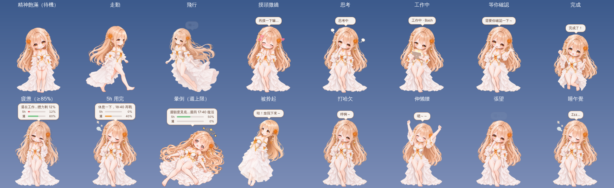

# 撫子桌寵 v0.5.9

會在螢幕下緣走來走去、偶爾飛一圈、被摸頭會害羞的撫子。她跟 Claude Code 連動：你送出提示她就開始想，Claude 動手用工具她就抱著平板工作，回答完會歡呼；用量超過 85% 會累，5 小時額度用完會睡著，碰到週上限會暈倒。



> 這張圖是在雲端容器裡用 Electron 實際跑出來的畫面截圖（透明背景疊在漸層上）。

### 更新紀錄
- **v0.5.9（2026-10-28）** 控制面板新增「語音工作室」，改台詞、試聽、換聲音都不用再開命令列，也不用找我：選一個狀態 → 列出它的 2～3 句（沒滿 3 句還能「＋新增一句」），每句可以分別改「頭上顯示的字」和「實際唸的字」；「▶ 試聽現有」直接播現有音檔，不用等隨機抽句、也不受冷卻影響；「生成」呼叫你電腦上的 Breeze 做**試聽檔**（只在記憶體裡，不會動到正式檔），可以一次連生 1～5 次挑一個最好的，每個版本顯示長度（太短通常就是尾字被吃掉）；滿意才按「採用這個」，這時才會改台詞表、換掉那一句的音檔，撫子立刻生效，不必重開。尾句被吃掉的對策做成每句可調：「句尾補幾個『……』」（0～5）與「後面再接幾毫秒靜音」（0～1500，純程式補，不需要 ffmpeg）；這兩個設定存在台詞表裡（`pad`、`tail`），之後用 `node tools/generate-voices.js` 重生也會照用。Breeze 的位置與聲音名稱在面板最下面的「Breeze 設定」改。連不上服務會直接告訴你。有 ffmpeg 採用時轉成 mp3，沒有就存 wav。
- **v0.5.8（2026-10-27）** 走路加入閉眼版（22-1、22-3-1、22-5-1、22-7-1），走到這四格剛好遇到眨眼就會閉眼，淡入的下一張也跟著閉眼。閉眼版的原圖被生圖拉高了一點（880 高變 896），等比縮放會讓眨眼時身高或寬度跳一下，所以改成「直接貼齊睜眼版的人物外框」（`prepare_sprites.py` 的 `match` 模式），四張的頭頂、腳底與睜眼版一致。暈倒後躺著揉眼（24-2）加入閉眼版 24-2-1，會眨兩下；24-2 換成祐去白邊後的新圖。飛行 54 加入頭髮裙子飄逸版 54-2，每 0.5 秒與 54 交替；54-2 的身體被生圖放大了約 2%，只對花飾的話身體會晃，所以新增 `fit` 模式：以花飾為起點，找讓臉、身體、腳重疊最好的縮放與位置，53-2 也改用這個方式。55／55-1 停用（祐在重畫更優雅的飛行姿勢），飛行現在在 53、54 之間隨機。
- **v0.5.7（2026-10-27）** 走路換成祐的 22 系列 7 張，照祐給的順序：起步「22 站姿 → 22-2」，接著在 22-3～22-7 之間來回循環（3 4 5 6 7 6 5 4 3 4 …），要停下來時播到 22-5 雙腳併攏再回 22 站姿。每張 0.14 秒，相鄰兩張之間有短暫淡入；身體在雙腳交會（22-5）時最高、大步幅（22-3、22-7）時最低，像真的走路一樣微微起伏。7 張的原圖大小都不一樣，處理時統一成身高 610／660（跟站姿 614 幾乎一樣），走路中人物高度固定。20、21 先放一邊（素材保留），舊的 15～19 原圖已從專案移除，對應設定先註解掉。
- **v0.5.6（2026-10-26）**
  - **走路換成祐新孵的 20、21**（舊的 15～19 先不用，素材保留）。兩張以「身高」對齊，都是 609／660，跟原本走路與站姿（614）幾乎同高，21 不會再看起來比較矮。一步一張、每步 0.5 秒，步伐中段身體微微抬起；換下一張前 0.14 秒先把下一張淡入，不會硬切。速度從每秒 0.32 提高到 0.4 個身長，腳比較不像在溜冰。
  - **飄落靈敏度固定成最敏感**，控制面板的滑桿拿掉：每 0.35 秒查一次，視窗動超過 1 像素就飄落。
  - **視窗偵測改成常駐**：以前每查一次就重開一個 PowerShell、重新編譯，加上 1.5 秒的快取，所以就算 v0.5.3 選「很靈敏」，實際也要 1.5～3 秒才發現視窗動了（v0.5.3 的說明不準，抱歉）。現在 PowerShell 只開一次、常駐等待，每次查詢應該只要幾毫秒；常駐那支出問題時會自動退回舊的一次性做法。另外查不到清單時不再誤判成「視窗消失」而掉下來。**這部分要在 Windows 實測**，我在 Linux 無法執行 PowerShell。
- **v0.5.5（2026-10-25）** 起身途中會定時眨眼：睡醒時 62-3 眨 2 次再接 62-4，62-4 再眨 1 次；暈倒爬起時 24-3 眨 2 次再接 62-4，62-4 再眨 1 次（加入 24-3-1 閉眼版）。每次眨眼約 0.16 秒，各段停留時間也拉長到 2.3／1.8 秒讓動作看得清楚。
- **v0.5.4（2026-10-25）** 暈倒爬起來有專屬動作：暈倒（24）→ 躺著揉眼睛（24-2）→ 坐著揉眼睛（24-3）→ 跪坐摸頭髮（62-4）→ 站起。24-2 用頭上橘花對齊 24，24-3 依花的大小調成跟跪坐圖一致、腳貼地。側睡醒來仍走原本的 62 系列。
- **v0.5.3（2026-10-24）** 控制面板新增「飄落靈敏度」（5 段，預設「普通」＝原本的 1.2 秒查一次、動超過 4 像素就飄落）。越靈敏查得越勤、門檻越小；越遲鈍則反過來，視窗輕微晃動不會把她嚇下來。
- **v0.5.2（2026-10-24）** 飛行加入第三種姿勢 53（53-1 閉眼版）；53-2 頭髮與蕾絲裙飄逸版會每約 0.5 秒與本體交替，已用頭上橘花的位置和大小對齊，切換時頭不會跳。飛行現在一趟隨機抽 53／54／55 其中一種。坐視窗邊緣 76／76-1 重新處理，座位線也重算。
- **v0.5.1（2026-10-24）** 修走路時有一張突然變大：四張走路圖（16、17、18、19）頭一樣大但身體長度差很多，現在統一成相同的身高（約 605／660，誤差 1%），走路高度不再忽大忽小；飛行改成**一趟隨機抽一種姿勢**（54 或 55，各自搭配自己的閉眼版），不再兩張輪流（輪流看起來像蛙式踢腿）。祐之後補的 54、55 頭髮裙子飄逸圖，可以接成同一姿勢的第二張。
- **v0.5.0（2026-10-22）** 換上祐新孵的素材：飛行兩種（54／55，含眨眼）、優雅緩降（78）、坐在視窗下緣第二種（80）、趴在視窗上（83）。停靠改成三種隨機：**趴在視窗上緣**、**坐在視窗下緣**（76 或 80 隨機，頭在視窗前面不怕頂到螢幕上方）、上緣夠低時才坐上緣；**視窗一移動或改變大小就不再黏過去，而是輕輕飄落到地面**（用 78）。要停的那條邊被別的視窗蓋住就不去。新增**頭上小字大小**（選單與控制面板的「字大小」，70%～220%，太長放不下時自動縮一點）。新台詞 `perch_lie`、`drop`；`node tools/generate-voices.js --check` 可列出還沒有音檔的台詞，測試會檢查程式用到的每個台詞鍵都在台詞表裡。
- **v0.4.1（2026-10-21）** 「找不到可以坐的視窗」改成會說明原因（PowerShell 無法啟動／逾時、沒偵測到視窗、視窗上緣太高）；視窗偵測改用暫存 .ps1 檔執行，第一次編譯的等待從 3 秒放寬到 15 秒。
- **v0.4.0（2026-10-21）** 新增：**坐到視窗邊緣**（76／76-1，Windows 限定：飛到別的視窗上緣坐著晃腳，視窗移動會跟著，關掉或搬走就飛回地面；右鍵可關、動作選單可手動觸發）、**害羞**（77／77-1：快速連點三下，或摸頭摸太久）、**依時段問候**（開機後與跨過早／午／下午／晚／深夜時各一句，文字加語音）、**對話泡泡換成橫向羊皮紙卷軸**。新增台詞 `perch`、`shy`、`greet_*` 共 21 句，**要重新執行 `node tools/generate-voices.js` 補音檔**（沒音檔只出字）。第八節「還缺的素材」已改寫，並列出身體比例需要修的編號。
- **v0.3.3（2026-10-21）** 換上祐修正頭部比例的第二種坐姿（63／63-1），並拿掉我先前為了補償頭太小而加的放大，頭的大小跟站姿接近。
- **v0.3.2（2026-10-21）**
  - **側睡不再飄起來**：側睡那張圖腳底下有一層零星的半透明殘影（約 110px），對齊地面時被當成腳底，人物實際浮在半空，點擊後才會「掉下去」。素材處理改成以不透明的實際底部對齊並清掉殘影（已驗證側睡時腳底貼地）。
  - **休眠喚醒後拎不起來**：你發現「重新調整尺寸就好」，我把「調尺寸」的動作做進喚醒流程：系統睡眠喚醒、解鎖、換顯示器、計時器突然隔很久（螢幕休眠）、以及每次開始拎起之前，都先把視窗大小差 1px 再改回來（透明視窗看不出來）並重建顯示資源。這是依你的線索推測的修法，我在 Linux 無法重現休眠，**請你實測**；若還是偶爾發生，用下面的喚醒快捷鍵一鍵修復。
  - **喚醒快捷鍵** `Ctrl+Alt+N`（Mac 是 Cmd+Option+N）：重整視窗、頂到最上層、人物醒來（躺著就爬起來，否則揮手）；人物在螢幕外會帶回右下角；按完可以直接點擊或拎起。系統匣圖示點一下、右鍵選單「喚醒」也是同樣效果。想換按鍵：關掉撫子，編輯設定檔 `settings.json` 的 `hotkey`（例如 `"CommandOrControl+Shift+F9"`）；設定檔在 Windows 通常是 `%APPDATA%\撫子桌寵\settings.json`（我沒能在 Windows 上確認資料夾名稱，找不到就在 `%APPDATA%` 底下搜尋 settings.json）。若按鍵被別的程式佔用，終端機會印出提示。
  - 快捷鍵本身我在 Linux 虛擬螢幕上無法測全域按鍵（只測了觸發後的行為：躺著會爬起來、站著會揮手、可拎起），請你按一次確認。
- **v0.3.1（2026-10-21）** 修正拎起時圖片切換：原本兩種拎起姿勢會中途互換（先像抱起來、下一秒歪身子）。現在每次拎起隨機選一種（抱起來／歪身子），整段都用同一種，各自會眨眼。新增 `SUGGESTIONS.md`（改進建言，做完的畫掉）。
- **v0.3.0（2026-10-21）** 新動作與羊皮紙面板。
  - **坐下等待**：沒人理約 80 秒後隨機坐下（跪坐或側坐，會眨眼），語音「我坐一下～」。
  - **側身睡覺**：約 5 分鐘沒人理就躺下側睡；5 小時額度用完也改成躺著睡（原本是站著閉眼）。
  - **睡醒爬起來**：躺著（睡覺或暈倒）時被摸、被點，或 Claude 開始工作／額度恢復，都會依序 撐起 → 坐起揉眼 → 準備站起，再回到站立。語音「嗯……我睡醒了」。
  - **工作中**兩張圖交替（低頭看平板 ↔ 抬頭）、**被拎起**兩張交替（亂踢腳）、**出錯**改成困惑表情（頭上問號、手拿平板）。
  - **眨眼**：思考、工作、疲憊、揮手、東張西望、坐姿、困惑都有閉眼版，每隔幾秒眨一下。
  - **控制面板**換成羊皮紙卷軸（無邊框，可拖曳上方卷軸移動，右上角 ✕ 關閉）；動作清單新增「坐下休息」「睡醒爬起來」。
  - **保持最上層**改用最高層級並每 3 秒重新頂上來，網頁或影片全螢幕時比較不會被蓋住。**Windows 上實際效果我無法驗證**：如果是「獨占全螢幕」的遊戲或程式，任何桌面視窗都蓋不上去，這是系統限制。
  - 右鍵選單仍是系統原生樣式（Electron 的原生選單不能換皮膚）；要做成羊皮紙需要自己畫一個選單視窗，等你的選單框架素材。
  - 新增語音台詞：坐下、睡醒各 3 句。**請重新執行** `node tools/generate-voices.js`（只會補缺的）。
- **v0.2.1（2026-10-20）** 台詞微調（驚嘆號改「～」避免斷尾音、稱呼改「主人」、疲憊／暈倒文字）；修正螢幕休眠喚醒後「能摸頭但拎不起來」：喚醒、解鎖、換顯示器時主程序重設滑鼠穿透狀態並清掉殘留按住狀態，另外滑鼠停在她身上時每秒自動重新宣告一次。（在 Linux 只能測到事件流程沒有錯誤，真正的休眠喚醒要請你在 Windows 上實測。）
- **v0.2.0（2026-10-20）** 新增「語音台詞」。
  - 21 種狀態／表情（打哈欠、揮手、摸頭、被拎起、思考、工作、完成、疲憊、暈倒…）各有 3 句台詞，每次隨機挑一句，不會連續重複；頭上小字會跟著唸的那句一起換。
  - 聲音是**事先生成好的音檔**（`app/voice/`），執行時只是播放，不需要 TTS 服務在跑。
  - 右鍵選單、控制面板都有「語音」開關與音量；沒有音檔時照常只出字，不會壞。
  - 重要：這包**不含音檔**（雲端環境連不到你的 Breeze），要在你的電腦上跑一次 `node tools/generate-voices.js`，見第 10 節。
- **v0.1.1（2026-10-20）** 修正「角色移動後，頭上泡泡停在右下角不跟著走」。
  - 泡泡改成每一格都重新對準她目前畫出來的頭頂（走路、飛行、被拎起、跳起來都跟著），下面多了指向頭的小尾巴。
  - 靠近螢幕左右邊緣時，泡泡自動往內側移，小尾巴仍指著頭；太靠上面時往下讓。
  - 視窗左右多留一段透明邊給泡泡用（透明處滑鼠照樣穿透）。
  - 移動視窗一律帶固定寬高（`setBounds`），並定期檢查尺寸：Windows 在 125%／150% 縮放時，反覆移動透明視窗可能讓視窗大小漂移，這很可能就是泡泡跑掉的原因。
  - 更新方式：關掉撫子，用新的 zip 覆蓋整個資料夾（`app/node_modules` 可以保留，不用重新下載 Electron），再雙擊 `start-windows.bat`。hooks 不用重裝。
- **v0.1（2026-10-19）** 第一版。

---

## 1. 最少步驟（Windows 11）

需要 **Node.js 20 以上，建議 22 LTS**（終端機打 `node -v` 確認；沒有就到 nodejs.org 裝 LTS 版）。

1. 把整個 `desktop-pet` 資料夾放到你喜歡的位置，例如 `C:\nadeshiko-pet`。
2. 雙擊 **`start-windows.bat`**。第一次會自動下載 Electron（約 100MB，要等一下），之後秒開。
3. 撫子出現在右下角後，在她身上 **按右鍵** → 「測試狀態」或「控制面板與模擬器…」先玩一輪，確認畫面正常。
4. 連動 Claude Code：在 `desktop-pet` 資料夾開終端機，執行
   ```
   node tools/install-claude.js --dry-run   ← 先看會改成什麼樣子（不寫檔）
   node tools/install-claude.js             ← 真的安裝（會先備份 settings.json）
   ```
   然後重開 Claude Code。想移除就 `node tools/install-claude.js --uninstall`，會還原成原本的樣子。

macOS 一樣，只是第 2 步改雙擊 `start-mac.command`（第一次可能要在「系統設定 → 隱私權與安全性」允許）。

也可以用 npm 指令：`npm run setup`（裝 Electron）、`npm start`（啟動）、`npm run hooks:install`、`npm test`（跑邏輯測試）。

## 2. 怎麼跟她互動

| 動作 | 結果 |
|---|---|
| 左鍵點一下 | 開心地跳一下、冒愛心 |
| 滑鼠在她頭上左右來回撫摸 | 摸頭撒嬌（臉紅雙手捧臉），停手就結束 |
| 按住拖曳 | 像被拎起後頸一樣晃來晃去，放開會掉回地面；從很高的地方放手會暈一下 |
| Ctrl + 滾輪（游標在她身上） | 放大縮小 |
| 右鍵 | 選單：尺寸、動作、測試狀態、各種開關、控制面板、結束 |
| 工作列的小圖示 | 跟右鍵選單一樣（她跑不見時用「回到螢幕右下角」） |

她身上透明的地方（包含左右留給泡泡的空白）滑鼠會直接穿過去，不會擋到底下的視窗。**尺寸、位置、開關都會記住**，下次開還是一樣。

### 尺寸
- 右鍵 → 尺寸：迷你 140 / 小 190 / 中 250 / 大 330 / 特大 440，或「放大一點、縮小一點」
- 控制面板的滑桿：100 到 640 像素任意調
- 縮放時以腳底為基準，不會跳走

## 3. 狀態怎麼決定

優先序（高的蓋過低的）：

**使用者互動**（拖曳、摸頭）＞ **暈倒** ＞ **睡覺（5h 用完）** ＞ **疲憊** ＞ **等你確認** ＞ **工作中** ＞ **思考** ＞ **完成** ＞ **隨機行為**

| 桌寵狀態 | 觸發條件 | 用的圖 |
|---|---|---|
| 暈倒 | 7 天用量 ≥ 100%，或 Claude 回報撞到用量上限且週用量接近滿 | `faint` |
| 睡覺 | 5 小時用量 ≥ 100%，或撞到上限但週用量還沒滿；頭上顯示幾點恢復 | `sleep` |
| 疲憊 | 5 小時或 7 天任一 ≥ 85%（門檻可在控制面板調）；偶爾打哈欠 | `tired` / `yawn` |
| 等你確認 | Claude 跳出權限詢問（`permission_prompt`） | `wave` 揮手 |
| 工作中 | Claude 正在用工具（`PreToolUse` / `PostToolUse`），頭上顯示工具名 | `work` |
| 思考 | 你剛送出提示（`UserPromptSubmit`） | `think` |
| 完成 | 回答結束（`Stop`），歡呼 6 秒 | `cheer` |
| 打招呼 | 開新工作階段（`SessionStart`） | `wave` |
| 隨機行為 | 沒事的時候：待機呼吸眨眼、走動、飛一圈、張望、打哈欠、伸懶腰、揮手、歡呼、換姿勢；被冷落 12 分鐘以上會睡午覺 | 各種 |

疲憊時如果 Claude 還在工作，頭上會寫「還在工作…體力剩 12%」，所以兩件事都看得到。滑鼠移到她身上會出現**體力條**（5h、週剩餘的百分比），疲憊以上會一直顯示；也可以在選單打開「體力條常駐」。

同時開好幾個 Claude Code 視窗時，取最忙的那一個。思考或工作超過 10 分鐘沒有新事件（例如 Claude 當掉），會自動當作結束。

## 4. 連動的原理（查證過官方文件）

資料都放在 `~/.nadeshiko-pet/`（Windows 是 `C:\Users\你\.nadeshiko-pet\`），右鍵「打開狀態資料夾」可以直接看：

```
sessions/<工作階段>.json   hooks 寫：這個 Claude Code 視窗正在做什麼
usage.json                狀態列腳本寫：5 小時 / 7 天用量與重置時間
limit.json                hooks 寫：剛剛撞到用量上限
```

桌寵每 0.6 秒讀一次。桌寵沒開時 hooks 照樣寫檔，不影響 Claude。

### 4.1 工作狀態：Claude Code hooks
來源：<https://code.claude.com/docs/en/hooks>

`install-claude.js` 會在 `~/.claude/settings.json` 的 `hooks` 裡，為這些事件加上 `node ".../hooks/pet-hook.js"`：
`SessionStart`、`UserPromptSubmit`、`PreToolUse`、`PostToolUse`、`PostToolUseFailure`、`PermissionRequest`、`Notification`、`SubagentStart`、`PreCompact`、`Stop`、`StopFailure`、`SessionEnd`。

- 每個 hook 都設 `"async": true`（官方欄位：在背景執行、不阻塞），腳本一律 exit 0、不輸出任何東西，**不會拖慢或擋住 Claude**。
- `StopFailure` 的 `error` 是 `rate_limit` 時代表撞到用量上限；`Notification` 的 `quota_auto_resume_fired` 代表額度恢復後自動續跑。
- 路徑一律寫成正斜線，因為 Windows 上 Claude Code 用 Git Bash 執行 hook，反斜線會被吃掉（官方文件有特別提醒）；沒有 Git Bash 時會改用 PowerShell，`node "C:/..."` 兩邊都能跑。
- 你原本的 hooks 都會保留，安裝前會備份成 `settings.json.bak-時間`。

### 4.2 用量：狀態列腳本收到的 `rate_limits`
來源：<https://code.claude.com/docs/en/statusline>

Claude Code 會把一包 JSON 從 stdin 傳給狀態列指令，其中：

```json
"rate_limits": {
  "five_hour": { "used_percentage": 23.5, "resets_at": 1738425600 },
  "seven_day": { "used_percentage": 41.2, "resets_at": 1738857600 }
}
```

- `used_percentage` 是 0 到 100，`resets_at` 是 Unix 秒。
- **只有 Pro / Max 訂閱才有**，而且要等工作階段第一次收到回應後才出現；兩個視窗可能各自缺席，過了 `resets_at` 也會被拿掉。腳本都有處理。
- 狀態列在「新的助手訊息到達」等時機才重跑（官方寫有 300ms 防抖），所以用量是**用 Claude Code 時才更新**，平常不會自己變。
- 安裝時如果你原本就有自己的狀態列，會被記在 `~/.nadeshiko-pet/statusline-chain.json`，撫子的腳本讀完用量後**照樣執行你原本的指令並顯示它的結果**，畫面不變。沒有的話會顯示 `撫子 │ 模型 │ ctx 12% │ 5h 24%（3h10m） │ 週 41%（2天後重置）`。

### 4.3 Claude Desktop 呢？（誠實評估）

- **Desktop 的「Code」分頁可以**：官方文件寫明 Desktop 與 CLI 共用 `~/.claude/settings.json`，hooks 兩邊都會觸發（<https://code.claude.com/docs/en/desktop> 的 Shared configuration 一節），所以思考、工作、完成、撞上限都會連動。
- **Desktop 的一般聊天沒有辦法**：它沒有 hooks、沒有狀態列、也沒有公開的本機事件介面，我找不到正當的本機訊號可以知道「它正在想」或「它用了多少」。不去硬湊（例如讀它的內部快取或截圖辨識），因為很容易壞、也不該碰。
- **用量是全帳號共用的**：5 小時與週額度是同一個方案在算，所以只要你偶爾用一下 Claude Code（終端機或 Desktop 的 Code 分頁），撫子就會拿到最新數字，包含你在 Desktop 聊天用掉的部分。
- 替代方案：控制面板的「模擬器」可以手動拉用量滑桿；或在終端機 `node tools/simulate.js usage 90 60` 直接設定。

## 5. 模擬器（驗收用，不需要 Claude）

**控制面板**（右鍵 →「控制面板與模擬器…」）：
- 「測試狀態」：直接切到任一狀態，選「自動」回到連動
- 「模擬器」：按鈕送出假的 Claude 事件（開新工作階段、送出提示、呼叫工具、要求權限、回答結束、撞到上限、額度恢復、API 錯誤、結束），走的是**跟真正 hooks 完全一樣的寫檔路徑**，所以這裡正常，接上 Claude 就會正常
- 兩條滑桿設定 5h / 7d 用量，按「送出用量」
- 下方即時顯示狀態檔內容

**命令列**：
```
node tools/simulate.js think          思考
node tools/simulate.js work Edit      工作中（工具名可省略）
node tools/simulate.js wait | done | hello | error
node tools/simulate.js usage 90 40    5h 90%、週 40% → 疲憊
node tools/simulate.js limit          撞到上限
node tools/simulate.js clear          清掉模擬資料
node tools/simulate.js demo           自動輪播全部狀態（約 1 分鐘）
```

## 6. 素材對照表

原圖沒有被修改。`tools/prepare_sprites.py` 會把 alpha < 8 的像素清成 0（Qwen 圖約 40% 的像素是肉眼看不到的 alpha=1 紫色殘留）、把非 1024 寬的圖縮到同一個角色比例、對齊到同一張畫布，輸出 660×660 的 PNG 到 `app/sprites/`。編號都是 `Qwen_image_2.1_000xx`；`-1` 是閉眼版，程式會自動拿來眨眼。

**對齊方式**：正面圖共用 00027 的位移（切換時身體完全不動）；側身、坐姿以頭部中心與腳底對齊；躺姿、飛行以外框中心對齊；24-2、24-3 用頭上橘花的位置與大小對齊；飄逸版（53-2、54-2）先用花飾對齊，再找讓臉、身體、腳重疊最好的縮放與位置（`fit` 模式）；閉眼版共用睜眼版的位移，原圖比例不同的（22 系列、24-2-1）直接貼齊睜眼版的人物外框（`match` 模式）。

| 狀態鍵 | 編號 | 用途 |
|---|---|---|
| idle / blink / happy | 27、28 | 待機、眨眼、被點一下的開心 |
| pat | 30 | 摸頭撒嬌 |
| curious / curious2 | 26、36（含 -1） | 張望、東張西望 |
| think | 31（含 -1） | 思考 |
| work / work2 | 32、60（含 -1） | 工作中（低頭看平板 ↔ 抬頭） |
| confused | 72（含 -1） | 出錯、困惑 |
| yawn / stretch | 33、35 | 打哈欠、伸懶腰 |
| wave | 38（含 -1） | 揮手、打招呼、等你確認 |
| cheer | 45 | 完成、歡呼 |
| tired | 23（含 -1） | 疲憊 |
| sleep | 42 | 站著打瞌睡（目前少用） |
| sleepside | 62 | 側睡（沒人理 5 分鐘、5 小時額度用完） |
| wake1～3 | 62-2、62-3（含 -1）、62-4（含 -1） | 睡醒爬起來（62-3 眨兩次、62-4 眨一次） |
| faint | 24 | 暈倒（週上限）、從高處摔下暈一下 |
| faint2 / faint3 | 24-2、24-3（皆含 -1） | 暈倒後躺著揉眼（眨兩下）→ 坐著揉眼（眨兩下），再接 62-4 站起 |
| sit1 / sit2 | 61、63（含 -1） | 坐下休息 |
| shy | 77（含 -1） | 害羞（連點三下、摸太久） |
| drag / drag2 | 59、68（含 -1） | 被拎起（每次隨機一種） |
| **step0、step2～step7** | **22、22-2～22-7**（22-1、22-3-1、22-5-1、22-7-1 閉眼） | **走路（目前使用）**：22 站姿 → 22-2 起步 → 22-3～22-7 來回 → 22-5 → 22 停下；走到有閉眼版的四格時會眨眼 |
| walk20 / walk21 | 20、21（從 00089 切出，存在 `walk-src/`） | 上一版走路，先放一邊 |
| （停用） | 16～19、uploads 裡的大跨步 | 舊走路，原圖已移除，`prepare_sprites.py` 裡先註解 |
| fly1 / fly3 | 54、53（含 -1） | 飛行，一趟隨機一種 |
| fly1_hair / fly3_hair | 54-2、53-2 | 頭髮裙子飄逸版，飛行時每 0.5 秒與本體交替 |
| （停用）fly2 | 55、55-1 | 祐在重畫更優雅的飛行姿勢；新圖放進來、把 `prepare_sprites.py` 的註解打開就會加回隨機 |
| float | 78 | 優雅緩降（視窗移動時飄落、從視窗上被叫下來） |
| sit_edge / sit_edge2 | 76、80（含 -1） | 坐在視窗下緣 |
| lie_top | 83（含 -1） | 趴在視窗上緣 |
| pose | uploads 裡最初的角色圖 | 隨機換姿勢 |

以後加新圖：把檔名加進 `prepare_sprites.py` 的 `SPRITES`，執行
`python tools/prepare_sprites.py --src <素材資料夾>`（需要 `pip install pillow numpy scipy`）。

## 7. 我自己決定、改了的地方

- **5 小時額度用完 → 睡覺，週上限才暈倒**。原本只有「85% 疲憊、週上限暈倒」，但 5h 用完也會被擋，用「睡到幾點再戰」比較貼切，也跟暈倒區分開。門檻三個都能在控制面板調。
- **體力條顯示「剩下多少」**而不是「用了多少」，頭上字也統一成「體力剩 12%」。
- **拖曳一律像拎後頸**：不管抓哪裡，都換成被拎起的圖、以頭為軸擺盪，放手會掉回地面，從很高放手會暈 2 秒。
- **眨眼**：00027 和 00028 只差眼睛，剛好拿來做待機眨眼（偶爾連眨兩下）。
- **側身與飛行圖放大 6–20%**：這兩組孵出來臉比正面小，不放大的話切換時會覺得人縮水。
- **走路圖以身高對齊而不是花飾**：同一組走路圖的原圖大小都不一樣，花飾又會因為頭轉的角度看起來忽大忽小，用花飾量會讓某幾張變矮（21 就是這樣）。現在每張都統一成身高 610／660，`prepare_sprites.py` 裡寫成 `"h610"`。
- **走路的起伏用程式做**：因為每張都統一身高，圖本身不會有高低差，所以由程式在雙腳交會時把身體抬高一點、大步幅時放低。
- **走路相鄰兩張之間淡入**：每張最後 40% 的時間把下一張疊上來，22 系列相鄰兩張很接近，看起來是連續動作，不會有殘影。
- **沒有用電腦補中間幀**：試過用光流自動推算 20、21 之間的中間幀，手臂會出現殘影，不採用；22 系列已經有足夠的中間幀。
- **換腳的判斷**（祐教的）：看胯下有沒有被前腳的大腿遮住，而不是看兩隻腳的位置。我之前說 20、21 沒有換腳是看錯了。
- **走路往左時鏡像**：新走路一樣是鏡像，花飾會跑到另一邊。
- **飄落固定最敏感**（祐定案）：控制面板不再有靈敏度設定。
- **飛行一趟只用一種姿勢**：兩種輪流看起來像蛙式踢腿。
- **閉眼版與飄逸版的對齊不完全照原圖比例**：生圖做編輯時常把整張圖拉長或放大 1～2%，照原比例縮放的話眨眼、飄動時人會微微跳。閉眼版直接貼齊睜眼版的外框（`match`）；飄逸版因為頭髮外框本來就不同，改成比對臉和身體的顏色找最吻合的位置（`fit`，處理一張約 30 秒）。
- **走路眨眼只在有閉眼版的四格發生**：22-2、22-4、22-6 沒有閉眼版，剛好輪到眨眼時就不眨，看起來是自然的偶爾眨眼。
- **起身動作的眨眼是固定節奏**，不是隨機，讓每次起身的節奏一樣。
- **頭上小字**：各狀態與動作有一句短台詞（「呼啊～」「哇！放我下來～」），不喜歡可以關。
- **保留你原本的狀態列**：安裝程式偵測到就串接，不會蓋掉。
- **被冷落 12 分鐘以上會睡午覺**，滑鼠或 Claude 有動靜就醒。
- 加了工作列小圖示和「回到螢幕右下角」，她跑到別的螢幕或找不到時用。

## 8. 還缺的素材與建議提示詞

**正面的圖請用 00027 當底圖做「圖片編輯」**（只改表情或手），這樣孵出來會跟現有的對齊，切換時身體不會抖。

共用角色描述（貼在每個提示詞前面）：
```
chibi anime girl, long wavy peach-blonde hair, large orange flower hair ornament on one side with dangling gold bead ornaments,
amber eyes, white off-shoulder ruffled tiered dress with orange bow and gold beaded trim, barefoot,
full body, soft cel shading, clean lineart, transparent background, no shadow on ground
```

### 已完成（~~劃掉~~）
- ~~各表情閉眼版（思考、工作、疲憊、坐姿、拎起…）~~
- ~~工作中第二張~~（60）、~~被拎起第二張~~（68）、~~出錯／困惑~~（72）
- ~~坐姿、側睡、起床三段~~（63、62、62-2～62-4）
- ~~坐在視窗邊緣~~（76、80，76 已由祐重做）、~~趴在視窗上~~（83）、~~害羞~~（77）、~~羊皮紙卷軸（面板與泡泡）~~
- ~~新飛行三種~~（53、54、55）、~~飛行頭髮裙子飄逸版~~（53-2）、~~優雅緩降~~（78）
- ~~暈倒後爬起來的專用版~~（24-2、24-3、24-3-1，接 62-4）、~~起身途中眨眼~~
- ~~新走路~~（20、21）→ ~~完整走路 7 張~~（22、22-2～22-7，含起步、換腳、雙腳交會、停步）
- ~~22 系列閉眼版~~（22-1、22-3-1、22-5-1、22-7-1）、~~24-2 閉眼版~~（24-2-1）、~~54 飄逸版~~（54-2）

### 還缺的（依重要性）

**祐要處理的素材（依重要性）：**

1. **新的飛行姿勢（取代 55）**（祐正在重畫）：建議跟 53、54 一樣做三張：本體、`-1` 閉眼、`-2` 頭髮裙子飄逸。優雅的方向可以試：`gliding gracefully, body tilted forward, one arm extended ahead and one trailing, legs together with toes pointed, skirt and long hair streaming behind`。檔名沿用 55 或給新編號都可以，告訴我就好。
2. **往左走的 22 系列**（想做才做）：目前往左是鏡像，花飾會跑到另一邊。不想多做的話，鏡像其實看不太出來。
3. **22-2、22-4、22-6 的閉眼版**（想做才做）：補上後走路任何一格都能眨眼；現在四格已經夠自然。
4. **待機微風版**：00027 的 `same pose and face, only hair and skirt hem swayed slightly by a gentle breeze`，與本體交替，站著也有生命感。
5. **視窗停靠的第二格**：坐在視窗邊緣（76、80）的晃腳版 `same pose, lower legs swung forward`；趴在視窗上（83）的小腿翹起版 `same pose, lower legs kicked up in the air`。
6. **54-2、53-2 的閉眼版**（想做才做）：飄逸那半秒目前不會眨眼，眨眼只發生在本體那半秒，影響很小。
7. **起飛前蹲、落地緩衝**（想做才做）：`crouching slightly, knees bent, about to jump`。
8. **右鍵選單的羊皮紙框**（想做才做）。
9. **20、21 的閉眼版**：20、21 現在沒在用，可以略過。

**關於走路**：22 系列七張已經是完整的一步（起步、大步、交會、換腳、停步），不需要再補中間幀。之後想讓待機、說話更細緻，再考慮 Live2D。

### 做圖小建議（新）
- 同一姿勢的兩格（本體＋飄動版）一定要用本體當底圖、鎖住姿勢與臉，只改頭髮與裙襬；不同姿勢才重新孵。
- 閉眼版也是同一招：用睜眼圖做編輯，只把眼睛改成閉上，我用本體的位置去對齊，不用自己對。
- 編輯後的圖如果畫布大小變了（例如 22-3 是 609×880，22-3-1 變成 608×896），人物會被拉長一點點；我這邊已經會自動拉回來，但如果工具有「保持原尺寸」的選項，打開會更準。
- 圖放到 uploads 後告訴我編號就好，位置、大小、腳底與閉眼對應我會處理。

### 身體比例需要修的編號（基準：00027 站姿）
量法：以頭上橙色花飾的直徑為尺（00027＝46px，統一畫布 660），再看「花飾到腳底」的比例。偏差超過 5% 的：

| 編號 | 用途 | 偏差 | 建議 |
|---|---|---|---|
| 00023、00023-1 | 疲憊 | 頭約小 9% | 修頭部比例 |
| 00035 | 伸懶腰 | 頭約小 7% | 修頭部比例（伸展姿勢有輕微縮短，影響不大） |
| 00078 | 優雅緩降 | 頭約小 17%（低頭有透視縮短，我已放大 1.05） | 看得順眼可略過 |
| 00083、00083-1 | 趴在視窗上 | 花飾在另一側被頭擋住，沒辦法用花飾量；目測頭約小 15%（我已放大 1.2；再大會超出畫布） | 看得順眼可略過 |

53、54、55、80、重做後的 76、走路 20、21 與 22 系列比例都很好；我用縮放補正、不用你修的：00018、00019、walk5（走路原本偏大，已縮小）、00077（害羞，縮到 0.94）、24 系列（以花飾大小對齊）。

**基準選 00027**：它是所有姿勢的底圖、眨眼與待機都用它，頭身比最接近設定的樣子；其他圖往它看齊。

## 9. 驗證狀況

在雲端容器（Linux + Xvfb）裡做到的：
- `npm test`：17 項測試全過（含台詞表檢查）（狀態機優先序、門檻、過期與上限判斷、hook 腳本實際讀 stdin 寫檔、狀態列腳本、安裝與移除時原設定完整保留並能還原原本狀態列）
- 用 Playwright 驅動 Electron 44 實際啟動：透明視窗、各狀態切換、走路會移動視窗、飛行、拖曳、摸頭偵測、控制面板改尺寸（以腳底為基準）、設定存檔、模擬器按鈕，畫面截圖就是上面那張

**沒驗證到、要你在自己電腦上看的：**
- Windows 上的點擊穿透手感（Linux 不支援 `forward` 參數，邏輯有寫但沒實測）、拖曳甩動的手感、工作列圖示
- 真正接上 Claude Code 的 hooks 與狀態列（文件查證過、腳本有用模擬輸入測，但沒有真的 Claude Code 可以跑）
- 高 DPI 縮放（125% / 150%）下的清晰度
- macOS 只照官方行為寫，完全沒測

遇到問題時：右鍵 →「打開狀態資料夾」看 JSON 有沒有在更新；hooks 可以在 Claude Code 裡打 `/hooks` 檢查；設定 `NADESHIKO_PET_DEBUG=1` 時 hook 錯誤會印到 stderr。

## 10. 語音台詞

### 運作方式
- 台詞表：`app/voice/lines.json`。每個狀態 2~3 句，`text` 是頭上小字，`say` 是實際唸出來的字（省略就唸 `text`，例如 `Zzz…` 唸成「呼……呼……」）。
- 音檔：`app/voice/<狀態>_<1~3>.mp3`（也認 `.ogg` / `.wav`）。檔名跟台詞表的順序對應，所以**改了台詞文字之後要重新生成該狀態**。
- 播放：動作類（打哈欠、揮手、摸頭、拖曳…）進入動作時挑一句，字與聲音同步；Claude 狀態類（思考、工作、完成、疲憊…）在狀態切換時只出聲，字仍是即時資訊（工具名稱、剩餘體力、恢復時間）。
- 不吵：同一狀態有冷卻（一般 4 秒；思考／工作 60 秒；疲憊／睡覺／暈倒 2 分鐘）；新的一句會蓋掉還沒唸完的舊句；關掉「語音」或音量 0 就完全靜音，字不受影響。
- 載入：第一次要唸才讀檔，之後留在記憶體；全部台詞總共約 1~2 MB（mp3，單聲道 24kHz 48kbps，每句 1~3 秒、約 10~25 KB）。若沒有 ffmpeg 而保留 Breeze 的 wav，每句約 100~300 KB，總共十幾 MB，也還能用，但建議裝 ffmpeg 轉 mp3。

### 語音工作室（控制面板，建議用這個）
右鍵 →「控制面板與模擬器…」，找到「語音工作室」。流程：選狀態 → 改字（可選）→ 調句尾 → **生成**（可連生幾次）→ 逐一**▶ 試聽** → 滿意就**採用這個**。不滿意就再生成，正式的音檔都不會變。
- 只改了頭上顯示的字、不想重做聲音：用「只存文字（不換音檔）」。
- 尾字被吃掉：先把「補幾個……」加到 2～3，再不行就把「接幾毫秒靜音」設成 200～400；長度欄位顯示的秒數可以拿來比對。
- 前提：Breeze-TTS 服務要先開著（位置預設 `http://127.0.0.1:8080`，聲音 `agent_girl`，可在面板改）。
- 一次只能處理一個請求，連生多次是依序做，所以會慢一點。
- 台詞表直接存在 `app/voice/lines.json`，之後想備份或放進 git 就是這個檔案加上 `app/voice/` 的音檔。

### 生成音檔（命令列，一次補很多句時用）
1. 先把 Breeze-TTS 服務開起來（預設 `http://127.0.0.1:8080`，聲音 `agent_girl`）。
2. 在 `desktop-pet` 資料夾執行：
   ```
   node tools/generate-voices.js
   ```
   已經有的音檔會跳過，只補缺的；`--force` 全部重做，`--only pat,wave` 只做指定狀態，`--list` 只列出不呼叫。
3. 重新啟動撫子（或右鍵關掉再開）。
- 句尾會自動補「……」避免尾音被吞；Breeze 一次只收一個請求，忙碌（409）時工具會自己等。
- 沒有 Breeze 可以用 `--engine edge`（先 `pip install edge-tts`），聲音是 `zh-TW-HsiaoChenNeural`。
- 想換聲音或服務位置：`--voice`、`--url`、`--model`。
- 台詞表裡有 `pad`、`tail`（語音工作室設定的句尾補字與靜音）時，這個工具會照用。

**誠實說明：** 生成工具我在雲端只用一個假的 Breeze 伺服器測過（確認請求格式、409 重試、轉 mp3、檔名、播放與音量都正常），沒有碰過真的 Breeze。請求格式是照 OpenAI 相容的 `/v1/audio/speech` 寫的；如果你的 Breeze 回錯誤，工具會把伺服器回的訊息印出來，貼給我就能修。

## 11. 檔案結構

```
desktop-pet/
├─ start-windows.bat / start-mac.command   雙擊啟動
├─ package.json                            npm 捷徑指令
├─ app/                                    Electron 桌寵本體
│  ├─ main.js                              視窗、選單、拖曳、設定、讀狀態檔
│  ├─ preload.js
│  ├─ lib/bridge.js                        讀寫狀態檔（hooks 也用這支）
│  ├─ lib/statecore.js                     狀態機（純函式，有測試）
│  ├─ lib/voicecore.js                     語音台詞挑選（純函式，有測試）
│  ├─ lib/voicestudio.js                   語音工作室核心：Breeze 生成、補句尾、寫回台詞表（有測試）
│  ├─ voice/                               lines.json 台詞表 + 生成的音檔
│  ├─ renderer/                            畫面、行為、控制面板
│  ├─ sprites/                             處理好的立繪 + manifest.json
│  └─ assets/                              圖示
├─ hooks/pet-hook.js                       Claude Code hook
├─ hooks/pet-statusline.js                 狀態列腳本（讀用量）
├─ tools/install-claude.js                 安裝／移除 hooks 與狀態列
├─ tools/generate-voices.js                生成語音音檔
├─ tools/simulate.js                       命令列模擬器
├─ tools/prepare_sprites.py                素材處理
├─ test/                                   node --test
└─ docs/states.png                         各狀態截圖
```
