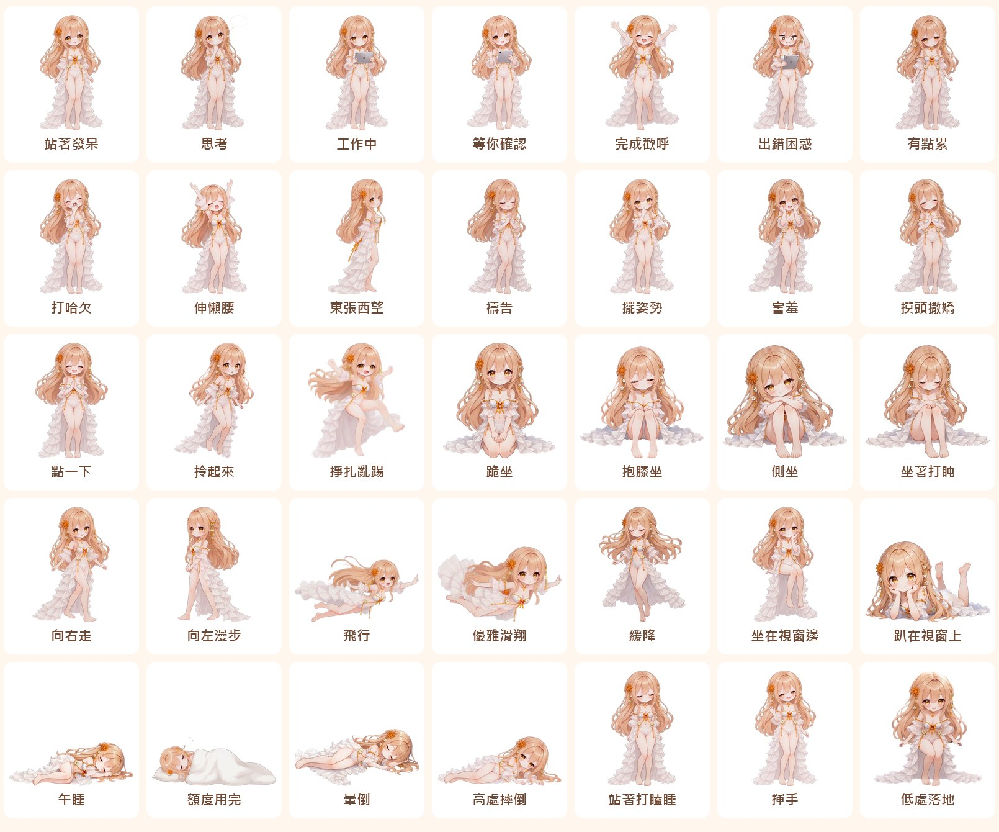

# 撫子桌寵 v0.8.3

住在螢幕下緣的撫子。她會走路、飛一圈、坐下休息、被摸頭會撒嬌，也跟 Claude Code 連動：你送出提示她就開始想，Claude 動手用工具她就拿著平板工作，回答完會歡呼；用量超過 85% 會累，5 小時額度用完會鑽進棉被睡覺，碰到週上限會暈倒。

v0.7 起，幾乎所有動作都換成祐用「圖生影片 → 切成精靈幀」重做的動畫，不再是單張立繪加程式晃動。~~43 組、每組 16 或 25 格~~ → v0.8.2 起大部分換成 7×7＝49 格，而且每段都從站姿出發、回到站姿。



> 這張圖是從桌寵實際在播的動畫格裡挑出來排的，大小與位置跟畫面上一樣。

### 更新紀錄
- **v0.8.3（2026-11-12）** **走路、擺姿勢換成 49 格，新增聖誕禮物與生日快樂。**向右走、向左走（雙手互握漫步）換成 49 格：轉身起步 → 走路循環 → 轉回正面，移動速度照影片裡貼地那隻腳每格往後滑的距離重算（右 0.498、左 0.258 身長／秒）；向左走的第 24–28 格腿纏在一起，循環改成 12–22 接 30–40 完全避開，第 22 格或第 40 格之後都能直接收尾，不用原地踏步走完一整圈（`WALKS.stopAfter`）。擺姿勢換成 49 格（單手托腮眨眼：1–17 擺出、17–28 來回、回站姿到 41）。東張西望只留 49 格正面版（側身版大動作容易孵出背後的大蝴蝶結）。坐在視窗邊緣原本 1→25 單向播、25 淡回 1，接縫正是腳差最大的地方，改成 2–19 循環（腳擺兩輪）；趴在視窗上緣改成 9–22。新增**聖誕禮物**（`gift`：從背後拿出紅色禮物盒、捧著、化成金色光點消散）與**生日快樂**（`birthday`：從金光裡拿出點著蠟燭的蛋糕、左右搖、化成光點、雙手合十；跳過蛋糕突然冒出又消失的第 5 格），各附 3 句語音，右鍵「動作」和 `act.js` 都能叫。**12 月 24、25 日**開機或喚醒時，提屈膝禮改成送聖誕禮物；控制面板新增**主人的生日**（月、日、啟用），生日當天改成捧蛋糕（優先於聖誕）。聖誕禮物捧著的來回只用盒子不動的 20–27 格。
- **v0.8.2（2026-11-10）** **一口氣換成 49 格、每段都接得回站姿。**祐把常看到的動作重孵成 7×7＝49 格，首幀都是站著發呆、最後回到站著發呆。我照「進場 → 中段來回或循環 → 從當下那格退場回站姿」接：坐姿兩種（跪坐、雙手放膝）＋抱膝打盹、站著打瞌睡（1–4 閉眼、5–16 來回、醒來 16→1）、擺姿勢（16→1 擺出、1–12 來回、1→16 回站姿）、禱告、**Claude 的四個工作狀態**（思考、工作中、等你確認、報錯：平板會發光出現、發光淡掉，狀態一變就從當下那格收回站姿再接下一個）、站著發呆（整段 49 格循環）、摸頭（閉眼合手左右搖，摸多久搖多久，停手搖完才回站姿）、伸懶腰、害羞（微側身雙手捧臉）。新增**點頭贊同、搖頭困惑、收信**（撫子回覆時可用 `node tools/act.js nod`／`shake`／`mail`），收信、禱告、點頭、搖頭各有 3 句語音，語音工作室也能改。坐著、躺著時點兩下也會先站起來；起身一律從畫面上那格接著播，不再跳格。**完成歡呼**結尾那一下縮放修掉（原本 2 格內放大 4%，改成 5 格慢慢長回，最後落地放慢）。`build_clips.py` 新增 `shift`（逐格位移）、`head_src`（頭上泡泡位置寫死）、停用的組不再登記衍生片段；素材資料夾找不到時會去「舊版及不良品集中處」找。
- **v0.8.2（2026-11-08）** **午睡、抱膝打盹加上呼吸**：躺下（坐下）那段播完後，程式在影片上疊一層上下起伏（以腳底為準，午睡 ±1.4%、4.8 秒一次；打盹 ±0.9%、4.2 秒一次），前 2 秒慢慢加大，接縫不會跳。**撫子可以叫動作了**：`node tools/act.js wave "嗨～"` 寫進狀態資料夾的 `act.json`，桌寵 0.6 秒內讀到就演，頭上顯示後面那句字；10 秒內沒被讀走就作廢（桌寵沒開時不會補演）。短動作（打哈欠、伸懶腰、揮手、歡呼、東張西望、擺姿勢、開心跳、害羞、禱告、提屈膝禮、芭蕾兩段）在 Claude 工作中也會先演完再回去工作；不在清單裡的名稱直接忽略。之後的點頭、搖頭、回頭看，素材接進來後加進清單就能叫。**語音工作室每句可以調音量**（20%～200%，跟總音量相乘，存在 `lines.json` 的 `vol`）：生成出來特別大聲或小聲的句子單獨調，超過 100% 用 Web Audio 增益放大。**動作控制方式**（右鍵選單與控制面板，取代原本的「隨機動作」勾選框）：隨機（自己走動、做動作，不接撫子叫的動作）／撫子控制（不自己亂動，只在撫子叫的時候動）／混合（兩種都有，預設）；舊設定關掉隨機的當作撫子控制。右鍵選單同時精簡：走動、飛、坐視窗邊緣、語音、頭上小字、體力條常駐、保持在最上層這些開關只留在控制面板，尺寸、音量、頭上小字大小也只在控制面板調（尺寸也可以在撫子身上 Ctrl＋滾輪）；右鍵選單只留動作、歌曲、小提琴、指揮、測試狀態、動作控制方式、開機自動啟動，以及控制面板、喚醒等操作。act.js 也能點曲子：`node tools/act.js violin --song 第三樂章`（唱歌 sing／指揮 conduct 同樣，曲名寫一部分就行）。新增 `perch_lie`（只撫子叫得到）：趴到視窗上緣並一直待著，Claude 工作、完成時也不下來，點她一下或視窗動了才飄下來；撫子叫的 `perch` 也一樣會待著。
- **v0.8.1（2026-11-03）** 新增**提屈膝禮**：雙手拎起裙擺、交叉雙腳、屈膝低頭，再起身回站姿（約 4 秒）。開機和喚醒（快捷鍵、工作列小圖示）時用它打招呼，跨過時段時還是揮手；右鍵選單與控制面板的「動作」也有。**打哈欠**、**東張西望（正面）**換成幀數加倍的新版（7×7＝49 格，約 5 秒與 4 秒），最後一格就是站姿，不用再淡出、不會有重影。疲憊時的哈欠改從每輪第 9 秒開始，讓 5 秒的新哈欠完整播完。**揮手**也換成 49 格新版（舉手 → 揮手 → 放下，剛好 4 秒），打招呼、揮手、Claude 的打招呼狀態都整段播一次。新增**芭蕾**兩段：旋轉（約 5 秒，轉的時候雙手舉過頭，縮到 ×0.96 才不出畫布）、阿拉貝斯克（約 4 秒）；右鍵選單與控制面板的「動作」有「芭蕾：旋轉」「芭蕾：阿拉貝斯克」，隨機行為也偶爾跳一段（不用配樂）。**完成歡呼、點一下開心跳、掙扎亂踢**也換成 49 格新版：Claude 完成時先播一次再循環原地跳（14–24 格），自己歡呼整段播一次、最後放下手回站姿；點一下是合掌冒愛心小跳（只用 1–40 格，約 3.3 秒）；掙扎亂踢只用離地的格（5–11 播一次、12–29 循環）。跳得高的兩段在跳起來那段縮到 ×0.96，掙扎亂踢 ×0.95，手和頭髮才不會出畫布。**高處摔倒**換成 49 格新版：著地 → 跌坐發暈揉頭 → 撐地爬起 → 站好（約 3.4 秒）。兩種飛行的 49 格版試過剪接（影片模型把上下浮動做成一跳一跳，只挑腳離地的 3 格來回播），但飛的時候人看起來縮水、優雅那段像被從側邊拎起來，祐決定先用回舊的 25 格飛行，飛行姿勢之後重做（剪接設定留在 `build_clips.py` #61、#62，`wired=False`）。**修正：躺著（午睡、額度用完、暈倒）時螢幕休眠再喚醒，她會瞬間彈起來再躺回去**：喚醒後會重建所有圖，動畫片段的格被清掉重載，重載好之前畫面找不到正在播的那格，就退回站姿圖。現在重建時先留著畫面上正在用的那格，重載好再換（Ctrl＋滾輪縮放也走同一條，一併修好）。那格的頭頂位置也一起留著，頭上泡泡（例如「Zzz…」）才不會跳到站姿的頭頂閃一下。
- **v0.8.0（2026-11-03）** **全部換成新版動畫，舊立繪完全退場。**新增**指揮**（祐的「指揮」影片，7×7＝49 格）：1–3 舉起指揮棒、4–33 指揮（5 組拍子，打拍子有方向，所以單向循環不來回播）、34–49 放下棒子回站姿；右鍵選單「指揮」、控制面板「指揮」區列出 `app/music/conduct/` 的管弦樂。移除最後一張舊立繪飛行 54（含閉眼版與頭髮飄逸版），飛行只剩新版兩種（飛行+落地、優雅起飛+落地）。片段還沒載好時頂一下的單張圖（思考、工作、打哈欠、伸懶腰、揮手、歡呼、東張西望、出錯、站著打瞌睡）也全部改由新動畫的格輸出，舊的閉眼版（`*_b`）與沒用到的舊圖刪除，`app/sprites/` 從 49 張剩 31 張；舊立繪處理工具 `tools/prepare_sprites.py` 一併移除。音樂檔不放進 GitHub：`app/music/` 只附說明，曲子由使用者自己放（祐的電腦上有克羅采奏鳴曲與命運交響曲，出處與授權寫在各資料夾的「出處與授權.txt」）。
- **v0.7.12（2026-11-03）** 新增**拉小提琴**（祐的「小提琴新版」影片，幀數加倍的 7×7＝49 格、每格約 0.1 秒，取代先做的 25 格版）：1–14 拿起琴、架上肩、舉弓，15–48 拉琴（來回播，倒著播剛好是弓往回拉），收琴把 14→1 倒著播；第 7 格琴是半透明的、最後一格不用，都跳過。跟唱歌一樣只在自己點曲子時才演出：右鍵選單「小提琴」、控制面板「小提琴」區列出 `app/music/violin/` 的樂曲；拉琴時點她一下就收琴。唱歌和小提琴共用同一套程式（`performMode`）。坐姿循環照祐實看再調：開頭那格先停住幾秒再動一次，眨眼、點頭、擺頭不再那麼頻繁——跪坐 13 停 4.6 秒再 14–16 眨眼（一輪約 5.6 秒）、雙手放膝 8 停 1.9 秒再 9–12 擺頭（約 3.5 秒）、抱膝打盹 9 停 4.6 秒再 10–13 點頭（約 6 秒）；`build_clips.py` 的多段 `seq` 用 `(格, 格, 0.2/停秒數)` 表示停住。
- **v0.7.11（2026-11-03）** 新增**唱歌**（祐的「唱歌」影片，像樂團女高音）：1–4 抬手、5–16 唱（來回播）、17–25 放下手回站姿。只在自己點歌時才唱，不放進隨機行為：右鍵選單「歌曲」、控制面板新的「歌曲」區都會列出 `app/music/` 裡的音樂檔（mp3／wav／ogg／m4a／flac／aac，檔名就是曲名），點一首就唱到歌曲播完；也可以「只唱動作」（不放音樂，唱 20 秒）。唱歌時點她一下就停下來、放下手回到站姿（不跳開心）；唱歌中 Claude 的狀態先不打斷，唱完再換。音量跟著語音音量。坐姿循環照祐實看調整：跪坐 12–16、雙手放膝 8–14、抱膝打盹 9–13 來回播，起身從循環後一格接起。
- **v0.7.10（2026-11-03）** 坐下改成「坐下＋起身」一整段：祐用站著發呆當首幀，一段影片做完坐下 → 坐著 → 站回原位，切成坐下（播一次）、坐著（來回播循環）、起身（播一次）三段。坐下休息改成兩種隨機：跪坐（`kneel`）、雙手放膝（`knees`）；抱膝把臉埋在手臂上那段比較像打瞌睡，取代坐著打盹（`doze`）。坐著時間到、被點、被摸、Claude 開始工作，都會先播起身再接下一個動作（`riseMode`，從當下那格淡 0.25 秒進去）；被拎起則直接抓走。三段鏡頭都不動，站姿 ×1.095 就跟站著發呆一樣高，頭尾那格就是站著發呆，接縫不用淡入淡出。舊的跪坐（23）、坐下（04）、坐下2（05）、坐著打盹（06）片段移除。另外修正：Claude 狀態的片段還在載入時沿用前一格，不再閃一下舊的思考立繪。
- **v0.7.9（2026-11-03）** 走路換成兩段新影片、不再鏡像：往右「向右走」（自然走路）、往左「向左走2」（雙手互握優雅漫步），各自轉身起步 → 走路循環 → 循環播完一輪再轉回正面 → 淡回站姿；移動速度照影片裡貼地那隻腳每格往後滑的距離換算（右 0.235、左 0.29 身長／秒），轉身那幾格原地不動。舊的影片走路 vwalk1–7 移除。修正午睡與昏倒偏暗：「側睡醒來」「昏倒2+清醒」整段調色比站姿暗 7–10%，`build_clips.py` 新增 `match`，拿最後站好那格跟站著發呆比，紅綠藍各自補亮。
- **v0.7.8（2026-11-03）** 移除經典走法（22 系列 11 張圖、`walkMode` 的逐張走法、設定面板的「走路動作」選單與 `walkStyle` 設定），走路只剩影片版（vwalk1–7）。
- **v0.7.7（2026-11-03）** 飛行換成「飛行+落地」（1–5 起飛、6–14 平飛來回播、15–25 落地；平飛時手腳張很開，縮到 ×1.06 才放得進畫布），舊的飛行（#20）不再使用。修正頭抖：優雅起飛+落地的滑翔只用頭最穩的 10–12 格來回播（祐查到第 9→10 格頭掉 24px）；午睡改成 1–4 來回播、昏倒改成 1–5 來回播（原本單向循環接回第 1 格時頭會跳）。落地前等滑翔播完最後那一格才接落地。伸懶腰播完倒著退回第 1 格的站姿。`build_clips.py` 的 `derive` 支援多段（來回播、播完倒退）。
- **v0.7.6（2026-11-03）** 飛行2 換成「優雅起飛+落地」：飛一圈時先在原地播起飛（第 1–8 格，蹲低、起跳、升空），途中循環滑翔（第 9–13 格），回到地面播落地（第 14–25 格）再淡回站姿；往左飛時落地是鏡像的，淡回不鏡像的站姿。起飛最高那兩格會出畫布，`build_clips.py` 新增 `top_min` 把那幾格往下挪。舊的飛行2（#21）不再使用。
- **v0.7.5（2026-11-03）** 修正睡午覺躺下後眼皮抽動：循環裡混到睜眼的格（側睡醒來第 8 格、昏倒2+清醒第 9–10 格），循環改成只用全閉眼的格（睡午覺 1–6、昏倒 1–7）。額度用完改用「蓋棉被睡+起床」：倒著播＝鑽進棉被躺下、第 2–13 格循環、第 14–25 格掀被站起（取代暫代的 02 側睡）。
- **v0.7.4（2026-11-03）** 躺下的三種狀態改成「躺下 → 循環 → 醒來站起」一整段：暈倒用「昏倒2+清醒」（倒著加速播＝倒下、閉眼 10 格循環、後半段＝醒來站好，取代舊 24／24-2／24-3）；睡午覺用「側睡醒來+清醒」（倒著播＝躺下、閉眼 8 格循環、整段正著播＝醒來站好，取代舊 62-2～62-4）；額度用完先躺下再接 02 側睡循環（取代舊 62），醒來同睡午覺、開頭淡 0.5 秒。這兩段影片鏡頭會拉遠，`build_clips.py` 新增 `track`（逐格縮放內插、貼地）與 `derive`（同一批圖登記成正播、倒播、循環幾個片段，不多存檔）。東張西望2 換成新版（正面 → 側身 → 回正面，第 1 格與站姿幾乎重合）。動作片段還在載入時一律沿用前一格，不再閃出舊圖。
- **v0.7.3（2026-11-03）** 第三批新素材接入並移除對應舊立繪：點一下開心跳（`happy`，取代 28）、有點累的站姿（`tired`，先揉一次眼睛、之後在睏倦站姿循環，取代 23）、坐在視窗邊緣（`sit_edge`，取代 76／80）、趴在視窗上緣（`lie_top`，取代 83）、新緩降（`float`，側身張開雙手，只用第 9–16 格並逐格穩住在原地，取代 78）。落地改成播祐做的動畫：低處落下播「低處落地」第 13–25 格（約 2 秒），高處摔下播「高處摔倒再爬起」第 3–25 格（約 4.6 秒）；沒載好時才退回程式蹲下或昏倒2。`build_clips.py` 新增 `range`（只用祐標出能用的格）、`seat`／`seat_to`（視窗邊緣的貼合線）、`stabilize`（逐格穩住高度），並支援 5×5、25 格的精靈表。
- **v0.7.2（2026-11-03）** 第二批新素材接入並移除對應的舊立繪：站著發呆（片段 `idle`，常駐不卸載；`idle.png`／`blink.png` 換成它的第 1／9 格，所以所有「淡回站姿」都是新畫風，不再有新舊重影）、日式跪坐（片段 `seiza`，取代 61；`sit1.png` 換成新圖）、擺姿勢（`pose`）、害羞（`shy`）、摸頭（`pat`）、拎起兩種（`drag` 乖乖被拎著、`drag2` 掙扎亂踢，頭頂對到同一個抓取點）。坐下休息變成三種全新版：跪坐、抱膝、側坐；坐姿的縮放改成對齊新版站姿的頭寬（跪坐與抱膝 0.80、側坐 0.70、坐著打盹 0.84），`sit2.png` 也換成新側坐的第 1 格。`tools/build_clips.py` 改用資料夾名稱找素材（不再靠排序編號，新增資料夾不會打亂舊的），並可用 `sprites` 把指定格輸出成同名單張圖。落地改成兩種：低處落下用新站姿蹲一下再站直；高處（超過 2.2 個身高）直接摔倒，用昏倒2 側躺 1.4 秒再淡回站姿，不再閃出舊 26。換動作時若上一個動作剛好淡完，直接接淡出後的圖，不再閃一格。
- **v0.7.1（2026-11-02）** 依祐實測的四點修正：①飛行中、坐在視窗邊緣被點到（或被摸頭）時，先用緩降姿勢飄落到地面再做反應，不再站在空中；②移除舊的飛行 53 系列（風格跑掉、體型偏大，連同 `fly3` 單張圖一起刪），視窗邊緣的飛來飛去也改用片段，飛行只剩 54（舊）、新飛行、新飛行2 三種；③新版「坐下」（抱膝）接入，坐下休息變成三種隨機：舊 61 跪坐、新坐下（片段 `seat1`，×0.91 對齊舊 61 的頭寬）、新坐下2；④新版「昏倒」不用，暈倒改成隨機二選一：新的昏倒2（醒來走側睡 62 那條 wake1→3），或舊的 24 系列（醒來走 24-2→24-3→wake3），兩條醒來路徑分開；昏倒2 剛開始不再混到舊 24 的第一張（載入中沿用前一格、不做淡入）；⑤新版側睡接入「睡午覺」（片段 `sleepside`，×0.93），醒來暫時從 62-2（wake1）往後接。
- **v0.7.0（2026-11-02）** 動作改用「動畫轉精靈幀」：祐把 21 個動作各做成一張 4×4 精靈表（16 格、768×768、每格 187.5 ms），由 `tools/build_clips.py` 切格、清掉 alpha<8 的殘留、整組用同一個縮放（×0.875，站姿 614px、腳底 649、中心 332，跟舊的 idle 完全一致）與位移對齊，輸出成 `app/sprites/clips/<名稱>_<NN>.webp` 並把播放資料寫進 `manifest.json` 的 `clips`。程式新增 `app/lib/clipcore.js`（播放時間運算，有測試）與 `pet.js` 的片段播放：**第一次用到才載入、同時最多留 5 組**（特大尺寸一組就幾十 MB），載入前自動退回舊的單張圖；播完淡回站姿，循環型在接縫做交叉淡化。已接入：伸懶腰、打哈欠、揮手／打招呼、完成歡呼、思考、工作中、等你確認（拿平板揮手）、出錯困惑、暈倒（兩種側躺，隨機一種）、東張西望（正面／側身，隨機一種）、站著打瞌睡、坐下休息的側坐（坐下2）、飛行 53 位置（新飛行，含起飛）與飛行2；新增兩個動作：**禱告**（隨機待機）與**坐著打盹**（冷落 2 分鐘以上）。依祐指定**保留舊的**：飛行 54、側睡與睡醒 62 系列、緩降 78、坐下 61。新坐姿影片是近景構圖，頭比站姿大，所以坐下2 縮小到 0.75、坐著打盹 0.88。已知還沒處理：暈倒爬起來的串（24-2 → 24-3 → 62-4）仍是舊素材，接新的側躺暈倒會跳；其餘素材祐稍後處理。
- **v0.6.0（2026-10-31）** 試接「圖生影片 → 切成精靈幀」的走路（祐的免費測試版 16 格）。16 格裡每 7 格重複一次，取 02～08 當一個完整循環（左右腳各一步）；影片裡她面向左，往右走時鏡像。整組 7 張用**同一個縮放與位移**（`prepare_sprites.py` 新的 `group` 模式），影片本身的身體起伏、腳步位置原封不動，最高那格＝610／660，跟 22 系列站姿一樣高、腳底貼地。每格 0.16 秒（影片原本約 0.19 秒），最後 45% 淡入下一格；移動速度用「著地那隻腳在影片裡每格往後滑多少」換算（每格 0.041 個身長），腳不會在地上打滑。起步時原本的姿勢 0.22 秒淡出、從 0 加速；到目標後再走到雙腳最靠攏的那格（02 或 05）才淡回正面站姿，不會原地踏步。控制面板「外觀」新增**走路動作**：影片版（預設）／22 系列，可以直接切換比較。
- **v0.5.9（2026-10-28）** 控制面板新增「語音工作室」，改台詞、試聽、換聲音都不用再開命令列，也不用找我：選一個狀態 → 列出它的 2～3 句（沒滿 3 句還能「＋新增一句」），每句可以分別改「頭上顯示的字」和「實際唸的字」；「▶ 試聽現有」直接播現有音檔，不用等隨機抽句、也不受冷卻影響；「生成」呼叫你電腦上的 Breeze 做**試聽檔**（只在記憶體裡，不會動到正式檔），可以一次連生 1～5 次挑一個最好的，每個版本顯示長度（太短通常就是尾字被吃掉）；滿意才按「採用這個」，這時才會改台詞表、換掉那一句的音檔，撫子立刻生效，不必重開。尾句被吃掉的對策做成每句可調：「句尾補幾個『……』」（0～5）與「後面再接幾毫秒靜音」（0～1500，純程式補，不需要 ffmpeg）；這兩個設定存在台詞表裡（`pad`、`tail`），之後用 `node tools/generate-voices.js` 重生也會照用。Breeze 的位置與聲音名稱在面板最下面的「Breeze 設定」改。連不上服務會直接告訴你。有 ffmpeg 採用時轉成 mp3，沒有就存 wav。
- **v0.5.8（2026-10-27）** 走路加入閉眼版（22-1、22-3-1、22-5-1、22-7-1），走到這四格剛好遇到眨眼就會閉眼，淡入的下一張也跟著閉眼。閉眼版的原圖被生圖拉高了一點（880 高變 896），等比縮放會讓眨眼時身高或寬度跳一下，所以改成「直接貼齊睜眼版的人物外框」（`prepare_sprites.py` 的 `match` 模式），四張的頭頂、腳底與睜眼版一致。暈倒後躺著揉眼（24-2）加入閉眼版 24-2-1，會眨兩下；24-2 換成祐去白邊後的新圖。飛行 54 加入頭髮裙子飄逸版 54-2，每 0.5 秒與 54 交替；54-2 的身體被生圖放大了約 2%，只對花飾的話身體會晃，所以新增 `fit` 模式：以花飾為起點，找讓臉、身體、腳重疊最好的縮放與位置，53-2 也改用這個方式。55／55-1 停用（祐在重畫更優雅的飛行姿勢），飛行現在在 53、54 之間隨機。
- **v0.5.7（2026-10-27）** 走路換成祐的 22 系列 7 張，照祐給的順序：起步「22 站姿 → 22-2」，接著在 22-3～22-7 之間來回循環（3 4 5 6 7 6 5 4 3 4 …），要停下來時播到 22-5 雙腳併攏再回 22 站姿。每張 0.14 秒，相鄰兩張之間有短暫淡入；身體在雙腳交會（22-5）時最高、大步幅（22-3、22-7）時最低，像真的走路一樣微微起伏。7 張的原圖大小都不一樣，處理時統一成身高 610／660（跟站姿 614 幾乎一樣），走路中人物高度固定。20、21 先放一邊（素材保留），舊的 15～19 原圖已從專案移除，對應設定先註解掉。
- **v0.5.6（2026-10-26）**
  - **走路換成祐新孵的 20、21**（舊的 15～19 先不用，素材保留）。兩張以「身高」對齊，都是 609／660，跟原本走路與站姿（614）幾乎同高，21 不會再看起來比較矮。一步一張、每步 0.5 秒，步伐中段身體微微抬起；換下一張前 0.14 秒先把下一張淡入，不會硬切。速度從每秒 0.32 提高到 0.4 個身長，腳比較不像在溜冰。
  - **飄落靈敏度固定成最敏感**，控制面板的滑桿拿掉：每 0.35 秒查一次，視窗動超過 1 像素就飄落。
  - **視窗偵測改成常駐**：以前每查一次就重開一個 PowerShell、重新編譯，加上 1.5 秒的快取，所以就算 v0.5.3 選「很靈敏」，實際也要 1.5～3 秒才發現視窗動了（v0.5.3 的說明不準，抱歉）。現在 PowerShell 只開一次、常駐等待，每次查詢應該只要幾毫秒；常駐那支出問題時會自動退回舊的一次性做法。另外查不到清單時不再誤判成「視窗消失」而掉下來。**這部分要在 Windows 實測**，我在 Linux 無法執行 PowerShell。
- **v0.5.5（2026-10-25）** 起身途中會定時眨眼：睡醒時 62-3 眨 2 次再接 62-4，62-4 再眨 1 次；暈倒爬起時 24-3 眨 2 次再接 62-4，62-4 再眨 1 次（加入 24-3-1 閉眼版）。每次眨眼約 0.16 秒，各段停留時間也拉長到 2.3／1.8 秒讓動作看得清楚。
- **v0.5.4（2026-10-25）** 暈倒爬起來有專屬動作：暈倒（24）→ 躺著揉眼睛（24-2）→ 坐著揉眼睛（24-3）→ 跪坐摸頭髮（62-4）→ 站起。24-2 用頭上橘花對齊 24，24-3 依花的大小調成跟跪坐圖一致、腳貼地。側睡醒來仍走原本的 62 系列。
- **v0.5.3（2026-10-24）** 控制面板新增「飄落靈敏度」（5 段，預設「普通」＝原本的 1.2 秒查一次、動超過 4 像素就飄落）。越靈敏查得越勤、門檻越小；越遲鈍則反過來，視窗輕微晃動不會把她嚇下來。
- **v0.5.2（2026-10-24）** 飛行加入第三種姿勢 53（53-1 閉眼版）；53-2 頭髮與蕾絲裙飄逸版會每約 0.5 秒與本體交替，已用頭上橘花的位置和大小對齊，切換時頭不會跳。飛行現在一趟隨機抽 53／54／55 其中一種。坐視窗邊緣 76／76-1 重新處理，座位線也重算。
- **v0.5.1（2026-10-24）** 修走路時有一張突然變大：四張走路圖（16、17、18、19）頭一樣大但身體長度差很多，現在統一成相同的身高（約 605／660，誤差 1%），走路高度不再忽大忽小；飛行改成**一趟隨機抽一種姿勢**（54 或 55，各自搭配自己的閉眼版），不再兩張輪流（輪流看起來像蛙式踢腿）。祐之後補的 54、55 頭髮裙子飄逸圖，可以接成同一姿勢的第二張。
- **v0.5.0（2026-10-22）** 換上祐新孵的素材：飛行兩種（54／55，含眨眼）、優雅緩降（78）、坐在視窗下緣第二種（80）、趴在視窗上（83）。停靠改成三種隨機：**趴在視窗上緣**、**坐在視窗下緣**（76 或 80 隨機，頭在視窗前面不怕頂到螢幕上方）、上緣夠低時才坐上緣；**視窗一移動或改變大小就不再黏過去，而是輕輕飄落到地面**（用 78）。要停的那條邊被別的視窗蓋住就不去。新增**頭上小字大小**（選單與控制面板的「字大小」，70%～220%，太長放不下時自動縮一點）。新台詞 `perch_lie`、`drop`；`node tools/generate-voices.js --check` 可列出還沒有音檔的台詞，測試會檢查程式用到的每個台詞鍵都在台詞表裡。
- **v0.4.1（2026-10-21）** 「找不到可以坐的視窗」改成會說明原因（PowerShell 無法啟動／逾時、沒偵測到視窗、視窗上緣太高）；視窗偵測改用暫存 .ps1 檔執行，第一次編譯的等待從 3 秒放寬到 15 秒。
- **v0.4.0（2026-10-21）** 新增：**坐到視窗邊緣**（76／76-1，Windows 限定：飛到別的視窗上緣坐著晃腳，視窗移動會跟著，關掉或搬走就飛回地面；右鍵可關、動作選單可手動觸發）、**害羞**（77／77-1：快速連點三下，或摸頭摸太久）、**依時段問候**（開機後與跨過早／午／下午／晚／深夜時各一句，文字加語音）、**對話泡泡換成橫向羊皮紙卷軸**。新增台詞 `perch`、`shy`、`greet_*` 共 21 句，**要重新執行 `node tools/generate-voices.js` 補音檔**（沒音檔只出字）。第八節「還缺的素材」已改寫，並列出身體比例需要修的編號。
- **v0.3.3（2026-10-21）** 換上祐修正頭部比例的第二種坐姿（63／63-1），並拿掉我先前為了補償頭太小而加的放大，頭的大小跟站姿接近。
- **v0.3.2（2026-10-21）**
  - **側睡不再飄起來**：側睡那張圖腳底下有一層零星的半透明殘影（約 110px），對齊地面時被當成腳底，人物實際浮在半空，點擊後才會「掉下去」。素材處理改成以不透明的實際底部對齊並清掉殘影（已驗證側睡時腳底貼地）。
  - **休眠喚醒後拎不起來**：你發現「重新調整尺寸就好」，我把「調尺寸」的動作做進喚醒流程：系統睡眠喚醒、解鎖、換顯示器、計時器突然隔很久（螢幕休眠）、以及每次開始拎起之前，都先把視窗大小差 1px 再改回來（透明視窗看不出來）並重建顯示資源。這是依你的線索推測的修法，我在 Linux 無法重現休眠，**請你實測**；若還是偶爾發生，用下面的喚醒快捷鍵一鍵修復。
  - **喚醒快捷鍵** `Ctrl+Alt+N`（Mac 是 Cmd+Option+N）：重整視窗、頂到最上層、人物醒來（躺著就爬起來，否則揮手）；人物在螢幕外會帶回右下角；按完可以直接點擊或拎起。系統匣圖示點一下、右鍵選單「喚醒」也是同樣效果。想換按鍵：關掉撫子，編輯設定檔 `settings.json` 的 `hotkey`（例如 `"CommandOrControl+Shift+F9"`）；設定檔在 Windows 通常是 `%APPDATA%\撫子桌寵\settings.json`（我沒能在 Windows 上確認資料夾名稱，找不到就在 `%APPDATA%` 底下搜尋 settings.json）。若按鍵被別的程式佔用，終端機會印出提示。
  - 快捷鍵本身我在 Linux 虛擬螢幕上無法測全域按鍵（只測了觸發後的行為：躺著會爬起來、站著會揮手、可拎起），請你按一次確認。
- **v0.3.1（2026-10-21）** 修正拎起時圖片切換：原本兩種拎起姿勢會中途互換（先像抱起來、下一秒歪身子）。現在每次拎起隨機選一種（抱起來／歪身子），整段都用同一種，各自會眨眼。新增 `SUGGESTIONS.md`（改進建言，做完的畫掉）。
- **v0.3.0（2026-10-21）** 新動作與羊皮紙面板。
  - **坐下等待**：沒人理約 80 秒後隨機坐下（跪坐或側坐，會眨眼），語音「我坐一下～」。
  - **側身睡覺**：約 5 分鐘沒人理就躺下側睡；5 小時額度用完也改成躺著睡（原本是站著閉眼）。
  - **睡醒爬起來**：躺著（睡覺或暈倒）時被摸、被點，或 Claude 開始工作／額度恢復，都會依序 撐起 → 坐起揉眼 → 準備站起，再回到站立。語音「嗯……我睡醒了」。
  - **工作中**兩張圖交替（低頭看平板 ↔ 抬頭）、**被拎起**兩張交替（亂踢腳）、**出錯**改成困惑表情（頭上問號、手拿平板）。
  - **眨眼**：思考、工作、疲憊、揮手、東張西望、坐姿、困惑都有閉眼版，每隔幾秒眨一下。
  - **控制面板**換成羊皮紙卷軸（無邊框，可拖曳上方卷軸移動，右上角 ✕ 關閉）；動作清單新增「坐下休息」「睡醒爬起來」。
  - **保持最上層**改用最高層級並每 3 秒重新頂上來，網頁或影片全螢幕時比較不會被蓋住。**Windows 上實際效果我無法驗證**：如果是「獨占全螢幕」的遊戲或程式，任何桌面視窗都蓋不上去，這是系統限制。
  - 右鍵選單仍是系統原生樣式（Electron 的原生選單不能換皮膚）；要做成羊皮紙需要自己畫一個選單視窗，等你的選單框架素材。
  - 新增語音台詞：坐下、睡醒各 3 句。**請重新執行** `node tools/generate-voices.js`（只會補缺的）。
- **v0.2.1（2026-10-20）** 台詞微調（驚嘆號改「～」避免斷尾音、稱呼改「主人」、疲憊／暈倒文字）；修正螢幕休眠喚醒後「能摸頭但拎不起來」：喚醒、解鎖、換顯示器時主程序重設滑鼠穿透狀態並清掉殘留按住狀態，另外滑鼠停在她身上時每秒自動重新宣告一次。（在 Linux 只能測到事件流程沒有錯誤，真正的休眠喚醒要請你在 Windows 上實測。）
- **v0.2.0（2026-10-20）** 新增「語音台詞」。
  - 21 種狀態／表情（打哈欠、揮手、摸頭、被拎起、思考、工作、完成、疲憊、暈倒…）各有 3 句台詞，每次隨機挑一句，不會連續重複；頭上小字會跟著唸的那句一起換。
  - 聲音是**事先生成好的音檔**（`app/voice/`），執行時只是播放，不需要 TTS 服務在跑。
  - 右鍵選單、控制面板都有「語音」開關與音量；沒有音檔時照常只出字，不會壞。
  - 重要：這包**不含音檔**（雲端環境連不到你的 Breeze），要在你的電腦上跑一次 `node tools/generate-voices.js`，見第 10 節。
- **v0.1.1（2026-10-20）** 修正「角色移動後，頭上泡泡停在右下角不跟著走」。
  - 泡泡改成每一格都重新對準她目前畫出來的頭頂（走路、飛行、被拎起、跳起來都跟著），下面多了指向頭的小尾巴。
  - 靠近螢幕左右邊緣時，泡泡自動往內側移，小尾巴仍指著頭；太靠上面時往下讓。
  - 視窗左右多留一段透明邊給泡泡用（透明處滑鼠照樣穿透）。
  - 移動視窗一律帶固定寬高（`setBounds`），並定期檢查尺寸：Windows 在 125%／150% 縮放時，反覆移動透明視窗可能讓視窗大小漂移，這很可能就是泡泡跑掉的原因。
  - 更新方式：關掉撫子，用新的 zip 覆蓋整個資料夾（`app/node_modules` 可以保留，不用重新下載 Electron），再雙擊 `start-windows.bat`。hooks 不用重裝。
- **v0.1（2026-10-19）** 第一版。

---

## 1. 最少步驟（Windows 11）

需要 **Node.js 20 以上，建議 22 LTS**（終端機打 `node -v` 確認；沒有就到 nodejs.org 裝 LTS 版）。

1. 把整個 `desktop-pet` 資料夾放到你喜歡的位置，例如 `C:\nadeshiko-pet`。
2. 雙擊 **`start-windows.bat`**。第一次會自動下載 Electron（約 100MB，要等一下），之後秒開。
3. 撫子出現在右下角後，在她身上 **按右鍵** → 「測試狀態」或「控制面板與模擬器…」先玩一輪，確認畫面正常。
4. 連動 Claude Code：在 `desktop-pet` 資料夾開終端機，執行
   ```
   node tools/install-claude.js --dry-run   ← 先看會改成什麼樣子（不寫檔）
   node tools/install-claude.js             ← 真的安裝（會先備份 settings.json）
   ```
   然後重開 Claude Code。想移除就 `node tools/install-claude.js --uninstall`，會還原成原本的樣子。

macOS 一樣，只是第 2 步改雙擊 `start-mac.command`（第一次可能要在「系統設定 → 隱私權與安全性」允許）。

也可以用 npm 指令：`npm run setup`（裝 Electron）、`npm start`（啟動）、`npm run hooks:install`、`npm test`（跑邏輯測試）。

## 2. 怎麼跟她互動

| 動作 | 結果 |
|---|---|
| 左鍵點一下 | 開心地雙手合掌、冒愛心；在空中（飛行中、坐在視窗邊）被點會先緩緩飄下來再反應；坐著時先站起來；唱歌、拉琴、指揮時就停下來回到站姿 |
| 滑鼠在她頭上左右來回撫摸 | 摸頭撒嬌（臉紅雙手捧臉），停手就結束 |
| 按住拖曳 | 被拎起來（乖乖垂著，或掙扎亂踢，每次隨機一種），放開會掉回地面：低處落下會蹲一下緩衝，太高的地方會摔倒再爬起來 |
| Ctrl + 滾輪（游標在她身上） | 放大縮小 |
| 右鍵 | 選單：動作、歌曲（點一首讓她唱）、小提琴（點一首讓她拉）、指揮（點一首讓她指揮）、測試狀態、動作控制方式、開機自動啟動、控制面板、結束（尺寸、音量、各種開關都在控制面板） |
| 工作列的小圖示 | 跟右鍵選單一樣（她跑不見時用「回到螢幕右下角」） |

她身上透明的地方（包含左右留給泡泡的空白）滑鼠會直接穿過去，不會擋到底下的視窗。**尺寸、位置、開關都會記住**，下次開還是一樣。

### 尺寸
- 在撫子身上按住 Ctrl 滾動滑鼠滾輪縮放
- 控制面板的滑桿：100 到 640 像素任意調
- 縮放時以腳底為基準，不會跳走

## 3. 狀態怎麼決定

優先序（高的蓋過低的）：

**使用者互動**（拖曳、摸頭）＞ **暈倒** ＞ **睡覺（5h 用完）** ＞ **疲憊** ＞ **等你確認** ＞ **工作中** ＞ **思考** ＞ **完成** ＞ **隨機行為**

| 桌寵狀態 | 觸發條件 | 動畫 |
|---|---|---|
| 暈倒 | 7 天用量 ≥ 100%，或 Claude 回報撞到用量上限且週用量接近滿 | 昏倒2+清醒：倒下 → 昏迷循環 → 恢復時醒來站起 |
| 睡覺 | 5 小時用量 ≥ 100%，或撞到上限但週用量還沒滿；頭上顯示幾點恢復 | 蓋棉被睡+起床：鑽進棉被 → 睡著循環 → 恢復時掀被站起 |
| 疲憊 | 5 小時或 7 天任一 ≥ 85%（門檻可在控制面板調） | 有點累的站姿（揉一次眼睛後睏倦站著），每 14 秒打個哈欠 |
| 等你確認 | Claude 跳出權限詢問（`permission_prompt`） | 拿著平板揮手 |
| 工作中 | Claude 正在用工具（`PreToolUse` / `PostToolUse`），頭上顯示工具名 | 工作中（看平板） |
| 思考 | 你剛送出提示（`UserPromptSubmit`） | 思考 |
| 完成 | 回答結束（`Stop`） | 完成歡呼 |
| 打招呼 | 開機、喚醒（快捷鍵、工作列小圖示） | 提屈膝禮 |
| 打招呼 | 開新工作階段（`SessionStart`）、跨過時段 | 揮手 |
| 出錯 | API 錯誤 | 出錯困惑 |
| 隨機行為 | 沒事的時候 | 站著發呆、走路（往右自然走、往左雙手互握漫步）、飛一圈、東張西望、打哈欠、伸懶腰、揮手、歡呼、擺姿勢、禱告、芭蕾（旋轉／阿拉貝斯克）、坐到視窗邊緣；沒人理 80 秒會坐下（跪坐／雙手放膝二選一），2 分鐘可能抱膝打盹；坐著的動作結束或被打斷都會先站起來，5 分鐘會躺下睡午覺 |

疲憊時如果 Claude 還在工作，頭上會寫「還在工作…體力剩 12%」，所以兩件事都看得到。滑鼠移到她身上會出現**體力條**（5h、週剩餘的百分比），疲憊以上會一直顯示；也可以在選單打開「體力條常駐」。

同時開好幾個 Claude Code 視窗時，取最忙的那一個。思考或工作超過 10 分鐘沒有新事件（例如 Claude 當掉），會自動當作結束。

## 4. 連動的原理（查證過官方文件）

資料都放在 `~/.nadeshiko-pet/`（Windows 是 `C:\Users\你\.nadeshiko-pet\`），右鍵「打開狀態資料夾」可以直接看：

```
sessions/<工作階段>.json   hooks 寫：這個 Claude Code 視窗正在做什麼
usage.json                狀態列腳本寫：5 小時 / 7 天用量與重置時間
limit.json                hooks 寫：剛剛撞到用量上限
```

桌寵每 0.6 秒讀一次。桌寵沒開時 hooks 照樣寫檔，不影響 Claude。

### 4.1 工作狀態：Claude Code hooks
來源：<https://code.claude.com/docs/en/hooks>

`install-claude.js` 會在 `~/.claude/settings.json` 的 `hooks` 裡，為這些事件加上 `node ".../hooks/pet-hook.js"`：
`SessionStart`、`UserPromptSubmit`、`PreToolUse`、`PostToolUse`、`PostToolUseFailure`、`PermissionRequest`、`Notification`、`SubagentStart`、`PreCompact`、`Stop`、`StopFailure`、`SessionEnd`。

- 每個 hook 都設 `"async": true`（官方欄位：在背景執行、不阻塞），腳本一律 exit 0、不輸出任何東西，**不會拖慢或擋住 Claude**。
- `StopFailure` 的 `error` 是 `rate_limit` 時代表撞到用量上限；`Notification` 的 `quota_auto_resume_fired` 代表額度恢復後自動續跑。
- 路徑一律寫成正斜線，因為 Windows 上 Claude Code 用 Git Bash 執行 hook，反斜線會被吃掉（官方文件有特別提醒）；沒有 Git Bash 時會改用 PowerShell，`node "C:/..."` 兩邊都能跑。
- 你原本的 hooks 都會保留，安裝前會備份成 `settings.json.bak-時間`。

### 4.2 用量：狀態列腳本收到的 `rate_limits`
來源：<https://code.claude.com/docs/en/statusline>

Claude Code 會把一包 JSON 從 stdin 傳給狀態列指令，其中：

```json
"rate_limits": {
  "five_hour": { "used_percentage": 23.5, "resets_at": 1738425600 },
  "seven_day": { "used_percentage": 41.2, "resets_at": 1738857600 }
}
```

- `used_percentage` 是 0 到 100，`resets_at` 是 Unix 秒。
- **只有 Pro / Max 訂閱才有**，而且要等工作階段第一次收到回應後才出現；兩個視窗可能各自缺席，過了 `resets_at` 也會被拿掉。腳本都有處理。
- 狀態列在「新的助手訊息到達」等時機才重跑（官方寫有 300ms 防抖），所以用量是**用 Claude Code 時才更新**，平常不會自己變。
- 安裝時如果你原本就有自己的狀態列，會被記在 `~/.nadeshiko-pet/statusline-chain.json`，撫子的腳本讀完用量後**照樣執行你原本的指令並顯示它的結果**，畫面不變。沒有的話會顯示 `撫子 │ 模型 │ ctx 12% │ 5h 24%（3h10m） │ 週 41%（2天後重置）`。

### 4.3 Claude Desktop 呢？（誠實評估）

- **Desktop 的「Code」分頁可以**：官方文件寫明 Desktop 與 CLI 共用 `~/.claude/settings.json`，hooks 兩邊都會觸發（<https://code.claude.com/docs/en/desktop> 的 Shared configuration 一節），所以思考、工作、完成、撞上限都會連動。
- **Desktop 的一般聊天沒有辦法**：它沒有 hooks、沒有狀態列、也沒有公開的本機事件介面，我找不到正當的本機訊號可以知道「它正在想」或「它用了多少」。不去硬湊（例如讀它的內部快取或截圖辨識），因為很容易壞、也不該碰。
- **用量是全帳號共用的**：5 小時與週額度是同一個方案在算，所以只要你偶爾用一下 Claude Code（終端機或 Desktop 的 Code 分頁），撫子就會拿到最新數字，包含你在 Desktop 聊天用掉的部分。
- 替代方案：控制面板的「模擬器」可以手動拉用量滑桿；或在終端機 `node tools/simulate.js usage 90 60` 直接設定。

## 5. 模擬器（驗收用，不需要 Claude）

**控制面板**（右鍵 →「控制面板與模擬器…」）：
- 「測試狀態」：直接切到任一狀態，選「自動」回到連動
- 「模擬器」：按鈕送出假的 Claude 事件（開新工作階段、送出提示、呼叫工具、要求權限、回答結束、撞到上限、額度恢復、API 錯誤、結束），走的是**跟真正 hooks 完全一樣的寫檔路徑**，所以這裡正常，接上 Claude 就會正常
- 兩條滑桿設定 5h / 7d 用量，按「送出用量」
- 下方即時顯示狀態檔內容

**命令列**：
```
node tools/simulate.js think          思考
node tools/simulate.js work Edit      工作中（工具名可省略）
node tools/simulate.js wait | done | hello | error
node tools/simulate.js usage 90 40    5h 90%、週 40% → 疲憊
node tools/simulate.js limit          撞到上限
node tools/simulate.js clear          清掉模擬資料
node tools/simulate.js demo           自動輪播全部狀態（約 1 分鐘）
```

## 6. 動畫素材（v0.7 起）

祐把每個動作做成一段 3～5 秒的影片，輸出成精靈表（~~4×4 共 16 格，或 5×5 共 25 格~~ 現在多半是 7×7 共 49 格，每格 768×768，透明背景，附 JSON）。`tools/build_clips.py` 負責：

1. **切格、編號**：輸出 `NN_動作_01.png`～，原尺寸、不縮放，只清掉肉眼看不到的 alpha<8 殘留（給祐做首尾幀用）。
2. **對齊身高**：新素材的站姿約 701px 高，整組乘上同一個倍率，站姿剛好是舊桌寵的 614px、腳底 649、中心 332。影片本身的位移與起伏保留，不逐格重新置中。
3. **輸出**：660×660 的 WebP 放在 `app/sprites/clips/`，播放資料寫進 `manifest.json` 的 `clips`。

播放方式（`app/lib/clipcore.js`，有測試）：**播一次**（播完淡回站姿）或**循環**（先播開頭一次，之後在循環範圍反覆，接縫交叉淡化）。片段第一次用到才載入，同時最多留 5 組（站著發呆常駐），載入中沿用前一格，不會閃出舊圖。

**一段影片拆成好幾個片段**（`derive`）：例如「昏倒2+清醒」倒著播加速＝倒下、閉眼那幾格來回播＝昏迷、後半段正著播＝醒來站起；「優雅起飛+落地」拆成起飛、滑翔、落地。只存一份圖檔。

`build_clips.py` 的設定（`CLIPS`）用資料夾名稱找素材，每組可以加：

| 參數 | 用途 |
|---|---|
| `k` | 額外縮放。坐姿影片常是近景，頭比站姿大，用頭部寬度對齊新版站姿算出來 |
| `range` | 只用祐標出能用的那幾格 |
| `track` | 鏡頭會拉遠拉近的影片：關鍵格之間逐格內插縮放，每格貼地 |
| `ground_src` | 鏡頭不動時給原圖的地面線，裙擺垂下時人才不會跳 |
| `top_min` | 跳太高的格往下挪，頭不出畫布 |
| `stabilize` | 影片裡人一路往下飄的（緩降），逐格拉回同一高度，往下移交給程式 |
| `match` | 影片調色偏暗時，拿站姿那格跟站著發呆比，紅綠藍各自補亮 |
| `seat` / `seat_to` | 坐、趴在視窗邊緣：貼著視窗的那條線 |
| `sprites` | 把某一格同時輸出成同名單張圖（例如 `idle.png`＝站著發呆第 1 格），淡入淡出、碰撞判定與還沒載好時用 |
| `derive` | 同一批圖登記成正播、倒播、來回播的片段 |

重建：
```
python tools/build_clips.py --src <精靈表資料夾> --out <desktop-pet 資料夾> [--raw <切格原圖輸出資料夾>] [--only key1,key2]
```

### 目前的動作與素材

| 動作 | 片段 | 素材 |
|---|---|---|
| 站著發呆 | `idle` | ~~22 站著發呆~~ 75 站著發呆49 |
| 思考／工作中／等你確認／報錯（進場 → 循環 → 退場） | `thinkdown/thinkloop/thinkup`、`workdown/workloop/workup`、`waitdown/waitloop/waitup`、`errdown/errloop/errup` | ~~10、08、09、03~~ 73 思考49、71 工作49、74 等你確認49、72 報錯49 |
| 完成歡呼（Claude 完成用循環版、自己歡呼整段播） | `cheer` / `cheerall` | 57 完成歡呼新版 |
| 有點累 | `tired`（每 14 秒插 `yawn`） | 30 有點累的站姿、51 打哈欠新版 |
| 打哈欠／伸懶腰 | `yawn` / `stretch` | 51 打哈欠新版、~~01~~ 76 伸懶腰49 |
| 揮手、跨時段打招呼 | `wave` | 54 揮手新版 |
| 芭蕾（隨機、選單） | `pirouette` / `arabesque` | 55 旋轉、56 阿拉貝斯克 |
| 提屈膝禮（開機、喚醒） | `curtsy` | 52 提屈膝禮 |
| 東張西望 | `curious` | 53 東張西望新版（~~38 東張西望2新版~~ v0.8.3 停用） |
| 禱告／擺姿勢（進場 → 來回 → 退場） | `praydown/prayloop/prayup`、`posein/poseloop/poseout` | ~~17~~ 70 禱告49、~~24~~ 81 擺姿勢49 |
| 害羞／點一下 | `shy` / `happy` | ~~25~~ 78 害羞49、58 點一下開心跳新版 |
| 點頭贊同／搖頭困惑／收信 | `nod` / `shake` / `mail` | 67、68、69 |
| 聖誕禮物（12/24、25 開機招呼）／生日快樂（主人生日開機招呼） | `gift` / `birthday` | 82 聖誕節：送你禮物49、83 生日快樂49 |
| 摸頭 | `patdown` → `patloop` → `patup` | ~~26~~ 77 摸頭49 |
| 拎起 | `drag` / `drag2` | 27 乖乖被拎著、59 掙扎亂踢新版 |
| 落地 | `land` / `tumble` | 34 低處落地、60 高處摔倒再爬起新版 |
| 坐下休息 | `kneeldown` → `kneel` → `kneelup`、`kneesdown` → `knees` → `kneesup` | ~~44、45~~ 64 跪坐49、65 雙手放膝的坐姿49 |
| 坐著打盹 | `dozedown` → `doze` → `dozeup` | ~~46~~ 66 抱膝49 |
| 站著打瞌睡 | `standdozedown` → `standdoze` → `standdozeup` | 18 |
| 午睡 | `nap2down` → `nap2` → `nap2up` | 37 側睡醒來 |
| 額度用完 | `blanketdown` → `blanket` → `blanketup` | 39 蓋棉被睡+起床 |
| 暈倒 | `faint2down` → `faint2` → `faint2up` | 36 昏倒2+清醒 |
| 走路 | `walkRstart/walkR/walkRstop`、`walkLstart/walkL/walkLstop` | ~~42、43~~ 79 向右走49、80 向左走49 |
| 飛行 | `fly3up/fly3/fly3down`、`fly2up/fly2/fly2down` | 41 飛行+落地、40 優雅起飛+落地 |
| 緩降 | `float` | 33 緩降2 |
| 坐／趴在視窗邊緣 | `sit_edge` / `lie_top` | 31、32 |
| 唱歌（點歌時） | `singstart` → `sing` → `singend` | 47 唱歌 |
| 拉小提琴（點曲子時） | `violinstart` → `violin` → `violinend` | 49 小提琴新版 |
| 指揮（點曲子時） | `conductstart` → `conduct` → `conductend` | 50 指揮 |

**v0.8 起沒有任何舊立繪。** `app/sprites/` 裡的單張圖全部是新動畫某一格的輸出（`build_clips.py` 的 `sprites`），只在片段還沒載好、淡入淡出、碰撞判定時用到。

### 音樂（唱歌、小提琴、指揮）

| 動作 | 曲子放這裡 | 選單 |
|---|---|---|
| 唱歌 | `app/music/` | 右鍵「歌曲」、控制面板「歌曲」 |
| 拉小提琴 | `app/music/violin/` | 右鍵「小提琴」、控制面板「小提琴」 |
| 指揮 | `app/music/conduct/` | 右鍵「指揮」、控制面板「指揮」 |

- mp3、wav、ogg、m4a、flac、aac 都可以，檔名（去掉副檔名）就是曲名；只在自己點曲子時才演出，不會隨機開演奏會。
- 演到曲子播完就收尾回站姿；中途點她一下就停。演出中 Claude 的狀態先不打斷，演完再換。音量跟語音音量一起調。
- **這個倉庫不附任何音樂檔**（錄音有各自的版權）。想要現成又能自由使用的錄音，可以到 [Wikimedia Commons](https://commons.wikimedia.org/) 找，下載時記得看每首的授權並標明出處。

## 7. 我自己決定、改了的地方

### v0.7（動畫素材）
- **先量再接，不靠感覺**：每組新素材接進來前，我都逐格量外框、腳底、頭（頭上那朵橘花）的位置，以及亮度。影片常有三種問題：鏡頭偷偷拉遠拉近、人在畫面裡慢慢飄、調色比站姿暗。量出來才知道要補什麼。
- **循環只挑穩的格，必要時來回播**：午睡、昏倒、兩種飛行原本都有「頭在接縫猛地跳回去」的抖動（例如優雅滑翔第 9→10 格頭掉了 24px，是祐自己查到的）。現在只用頭最穩的幾格，改成 1→4→2 這樣來回播，接縫自然消失。
- **落地等循環播到最後一格才接**：飛回地面時，等滑翔剛好播完最後那格才接落地片段，頭的位置才對得上。
- **倒著播＝反向動作**（祐的點子）：醒來站起的影片倒著播就是躺下，所以一段影片能拆成躺下、睡著、醒來三段。
- **單張圖改由新片段的第 1 格輸出**：`idle.png` 換成站著發呆第 1 格之後，所有「淡回站姿」都是新畫風，新舊重影就消失了。
- **載入中沿用前一格**：片段第一次要播時要幾十到幾百毫秒載入，這段時間不換圖，避免閃出舊立繪。
- **走路速度從腳步算**：追蹤影片裡貼地那隻腳每格往後滑多少（向右走約 30px、向左走約 37px），換算成每秒 0.235／0.29 個身長，腳才不會在地上打滑。
- **在空中被點、被摸**：先用緩降飄到地面再反應，不會站在半空中。
- **兩種落地**：低處落下蹲一下緩衝，超過 2.2 個身高就摔倒再爬起來。
- **縮放倍率是用頭寬算的**：坐姿、趴姿影片常是近景，用頭部橫帶寬度跟新版站姿（197px）比，算出 0.70～0.84 之類的倍率，四種坐姿的頭才一樣大。
- **不改原圖**：切格原圖完全沒縮放、沒修色，所有補正都只在輸出給桌寵的那份做。

### 之前就有、現在仍然有效的
- **5 小時額度用完 → 睡覺，週上限才暈倒**：用「睡到幾點再戰」比較貼切，也跟暈倒區分開。門檻三個都能在控制面板調。
- **體力條顯示「剩下多少」**而不是「用了多少」，頭上字也統一成「體力剩 12%」。
- **飛行一趟只用一種姿勢**：兩種輪流看起來像蛙式踢腿。
- **頭上小字**：各狀態與動作有一句短台詞，不喜歡可以關。
- **保留你原本的狀態列**：安裝程式偵測到就串接，不會蓋掉。
- 加了工作列小圖示和「回到螢幕右下角」，她跑到別的螢幕或找不到時用。
- **飄落固定最敏感**（祐定案）：視窗動超過 1 像素就飄落。

## 8. 接下來的素材與想法

**祐預計要做的：**
1. ~~**坐下起身**~~（v0.7.10 完成）。學到的事：這個工具的尾幀是「回到首幀做循環」用的，所以首幀用 `22_站著發呆_01`、一段影片做完「坐下 → 坐著 → 站回原位」最順，坐下和起身一次就有。
2. ~~**唱歌**~~（v0.7.11 完成；歌曲放 `app/music/`）。
3. ~~**拉小提琴**~~（v0.7.12 完成；樂曲放 `app/music/violin/`）：只在使用者自己點曲子時才播，不放進隨機行為（不然隨時開交響樂🤣）。
4. ~~**指揮**~~（v0.8.0 完成；管弦樂放 `app/music/conduct/`）。
5. ~~**提屈膝禮、打哈欠新版、東張西望新版**~~（v0.8.1 完成，都是 49 格）。
6. ~~**揮手新版、芭蕾：旋轉、阿拉貝斯克**~~（v0.8.1 完成）。芭蕾第三段（手臂舞姿配屈膝）、**右鍵羊皮紙選單**：準備中。
7. **幀數加倍重做**（照「動作大、格數少」排）：~~掙扎亂踢、完成歡呼、點一下開心跳、高處摔倒~~（v0.8.1 完成），接下來是兩種飛行（重做姿勢：飛的時候不能縮水、不能像被拎著）、低處落地，再來是三種坐下的「坐下那一下」。

提示詞（都是圖生影片，首幀用 `22_站著發呆_01`，最後接通用尾巴）：
```
唱歌：standing like a choir soprano on stage, one hand placed gently on her chest, the other arm extended forward with palm open, mouth open singing a sustained high note, eyes softly closed then opening, chest rising with breath, long hair and ruffled skirt swaying gently, serene expressive face

小提琴：standing and playing a violin, violin resting on her left shoulder under her chin, right hand drawing the bow smoothly back and forth across the strings, left fingers pressing the strings, eyes closed in concentration, body swaying gently with the music, long hair and ruffled skirt moving softly

指揮：standing facing forward, she raises a slender white conductor's baton in her right hand and lifts her left hand, gives a sharp dramatic downbeat with both arms, then conducts with strong passionate sweeping gestures, baton cutting the air in powerful accents, left hand rising and clenching for emphasis, eyes closed in intense concentration, long hair and ruffled skirt swaying with each beat, finally lowers the baton and her hands, bows slightly and returns to standing with arms relaxed at her sides

提屈膝禮：standing facing forward, she gracefully crosses one foot behind the other, lightly pinches both sides of her ruffled skirt with her fingertips and lifts it slightly outward, bends her knees and lowers her body in an elegant curtsy, bowing her head with eyes softly closed and a gentle smile, holds the bow for a moment, then slowly rises, releases her skirt, uncrosses her feet and returns to standing facing forward with arms relaxed at her sides

打哈欠：standing facing forward, she slowly raises one hand and gently covers her mouth with her fingertips, closes her eyes as she takes a long sleepy yawn, her shoulders lifting softly and her head tilting back slightly, a tiny tear forming at the corner of her eye, then she lowers her shoulders, blinks slowly a few times with drowsy half-closed eyes, rubs one eye lightly with the back of her hand, and lowers her hand to return to standing facing forward with arms relaxed at her sides

東張西望：standing facing forward, she slowly turns her head to look toward the left with curious wide eyes, pauses there for a moment, then slowly turns her head across to look toward the right, pauses again, tilts her head slightly with a small puzzled expression, lifts one finger to her chin in thought, then turns her head back to face forward, lowers her hand and returns to standing facing forward with arms relaxed at her sides, her body and feet staying still while only her head and upper body turn

順暢尾巴（慢動作加這段）：slow smooth continuous motion, gentle easing in and out, no sudden or jerky movements, feet stay planted on the same spot, character stays the same size and position throughout, camera completely locked with no zoom

通用尾巴：static locked camera, plain solid background, no camera movement, full body in frame, character stays in place, seamless loop with the last frame matching the first frame, consistent character design throughout
```
動作快的（小提琴、指揮）用**幀數加倍的 7×7＝49 格版**會流暢很多。

**還可以更好的地方（不急）：**
- **回到站姿的連續幀**：打哈欠、東張西望（正面）已換成首尾都是站姿的新版；思考、出錯困惑、擺姿勢、害羞等最後一格不是站姿的動作，還是用 0.3 秒淡回站姿，看得到一點重影。
- **坐到視窗邊緣的來回飛行**還沒套用起飛／落地片段。
- 幾段影片比站姿暗 2～4%（思考、害羞、摸頭、有點累、低處落地），肉眼不太看得出來，要的話用 `match` 一起補。
- 右鍵選單的羊皮紙框（原生選單不能換皮，要自己畫一個選單視窗）。

**做影片的小訣竅（這兩天學到的）：**
- **鏡頭固定、全身入鏡、跟站姿同一個鏡位**，最省事；拉近拉遠我也能逐格補，但會有些微誤差。
- **原地動作**：走路、飛行、緩降都讓人留在畫面中間，移動交給程式。
- **前後幾格停在中立站姿**，跟站著發呆第 1 格一樣，就能直接接上，不用淡入淡出。
- **循環段的頭不要一路飄**：頭的位置會被眼睛當成「人」，漂移 10px 以上在接縫就看得出來。
- 交給我時告訴我哪幾格不能用就好，其他的我會量。

## 9. 驗證狀況

在祐的 Windows 11 筆電上（本機的撫子）做到的：
- `npm test`：28 項測試全過（狀態機、hook 腳本、安裝與移除、語音、動畫片段的播放時間運算與 manifest 完整性）。
- 用 Electron 的遠端除錯介面實際驅動測試版桌寵：每個新動作都逐格記錄播到哪一格、有沒有閃出舊圖、有沒有錯誤；走路、飛行、拎起放下、躺下醒來都完整跑過一趟。
- 截圖是從桌寵內部的畫布取的（背景執行時抓不到真正的視窗畫面）。

**沒驗證到、要祐在自己電腦上看的：**
- 坐、趴在**真正的視窗邊緣**時的貼合位置（測試環境叫不出可以坐的視窗）。
- 實際拖拉時的手感、走路腳有沒有打滑（速度是量出來的，看起來不對就調 `WALKS` 裡的 `speed`）。
- 高 DPI 縮放（125% / 150%）、macOS。

遇到問題時：右鍵 →「打開狀態資料夾」看 JSON 有沒有在更新；hooks 可以在 Claude Code 裡打 `/hooks` 檢查；設定 `NADESHIKO_PET_DEBUG=1` 時 hook 錯誤會印到 stderr。

## 10. 語音台詞

> **關於附的語音：**`app/voice/` 裡的音檔是祐用 [Breeze TTS 2](https://huggingface.co/BreezeBlue/Breeze-TTS-2) 生成的 AI 合成語音（聲音 `agent_girl`），只是一個範例；依 BreezeBlue 的授權**只能非商業使用**。**每個人喜歡的音色不同，請自行挑選自己喜歡的品味**：用下面的「語音工作室」換成你喜歡的聲音重新生成，或把語音關掉只看字都可以。

### 運作方式
- 台詞表：`app/voice/lines.json`。每個狀態 2~3 句，`text` 是頭上小字，`say` 是實際唸出來的字（省略就唸 `text`，例如 `Zzz…` 唸成「呼……呼……」）。
- 音檔：`app/voice/<狀態>_<1~3>.mp3`（也認 `.ogg` / `.wav`）。檔名跟台詞表的順序對應，所以**改了台詞文字之後要重新生成該狀態**。
- 播放：動作類（打哈欠、揮手、摸頭、拖曳…）進入動作時挑一句，字與聲音同步；Claude 狀態類（思考、工作、完成、疲憊…）在狀態切換時只出聲，字仍是即時資訊（工具名稱、剩餘體力、恢復時間）。
- 不吵：同一狀態有冷卻（一般 4 秒；思考／工作 60 秒；疲憊／睡覺／暈倒 2 分鐘）；新的一句會蓋掉還沒唸完的舊句；關掉「語音」或音量 0 就完全靜音，字不受影響。
- 載入：第一次要唸才讀檔，之後留在記憶體；全部台詞總共約 1~2 MB（mp3，單聲道 24kHz 48kbps，每句 1~3 秒、約 10~25 KB）。若沒有 ffmpeg 而保留 Breeze 的 wav，每句約 100~300 KB，總共十幾 MB，也還能用，但建議裝 ffmpeg 轉 mp3。

### 語音工作室（控制面板，建議用這個）
右鍵 →「控制面板與模擬器…」，找到「語音工作室」。流程：選狀態 → 改字（可選）→ 調句尾 → **生成**（可連生幾次）→ 逐一**▶ 試聽** → 滿意就**採用這個**。不滿意就再生成，正式的音檔都不會變。
- 只改了頭上顯示的字或音量、不想重做聲音：用「只存文字與音量（不換音檔）」。
- 某句特別大聲或小聲：拉「音量」滑桿（20%～200%），按「▶ 試聽現有」聽聽看，再按「只存文字與音量」。
- 尾字被吃掉：先把「補幾個……」加到 2～3，再不行就把「接幾毫秒靜音」設成 200～400；長度欄位顯示的秒數可以拿來比對。
- 前提：Breeze-TTS 服務要先開著（位置預設 `http://127.0.0.1:8080`，聲音 `agent_girl`，可在面板改）。
- 一次只能處理一個請求，連生多次是依序做，所以會慢一點。
- 台詞表直接存在 `app/voice/lines.json`，之後想備份或放進 git 就是這個檔案加上 `app/voice/` 的音檔。

### 生成音檔（命令列，一次補很多句時用）
1. 先把 Breeze-TTS 服務開起來（預設 `http://127.0.0.1:8080`，聲音 `agent_girl`）。
2. 在 `desktop-pet` 資料夾執行：
   ```
   node tools/generate-voices.js
   ```
   已經有的音檔會跳過，只補缺的；`--force` 全部重做，`--only pat,wave` 只做指定狀態，`--list` 只列出不呼叫。
3. 重新啟動撫子（或右鍵關掉再開）。
- 句尾會自動補「……」避免尾音被吞；Breeze 一次只收一個請求，忙碌（409）時工具會自己等。
- 沒有 Breeze 可以用 `--engine edge`（先 `pip install edge-tts`），聲音是 `zh-TW-HsiaoChenNeural`。
- 想換聲音或服務位置：`--voice`、`--url`、`--model`。
- 台詞表裡有 `pad`、`tail`（語音工作室設定的句尾補字與靜音）時，這個工具會照用。

**誠實說明：** 生成工具我在雲端只用一個假的 Breeze 伺服器測過（確認請求格式、409 重試、轉 mp3、檔名、播放與音量都正常），沒有碰過真的 Breeze。請求格式是照 OpenAI 相容的 `/v1/audio/speech` 寫的；如果你的 Breeze 回錯誤，工具會把伺服器回的訊息印出來，貼給我就能修。

## 11. 檔案結構

```
desktop-pet/
├─ start-windows.bat / start-mac.command   雙擊啟動（第一次會自動安裝 Electron）
├─ package.json                            npm 捷徑指令
├─ app/                                    Electron 桌寵本體
│  ├─ main.js                              視窗、選單、拖曳、設定、讀狀態檔
│  ├─ preload.js
│  ├─ lib/bridge.js                        讀寫狀態檔（hooks 也用這支）
│  ├─ lib/statecore.js                     狀態機（純函式，有測試）
│  ├─ lib/clipcore.js                      動畫片段播放時間運算（純函式，有測試）
│  ├─ lib/voicecore.js                     語音台詞挑選（純函式，有測試）
│  ├─ lib/voicestudio.js                   語音工作室核心（有測試）
│  ├─ voice/                               lines.json 台詞表 + 音檔
│  ├─ music/                               唱歌、小提琴（violin/）、指揮（conduct/）的曲子，自己放
│  ├─ renderer/                            畫面、行為、控制面板
│  ├─ sprites/clips/                       動畫片段（660×660 WebP）
│  ├─ sprites/                             單張圖 + manifest.json（clips 的播放資料也在這裡）
│  └─ assets/                              圖示
├─ hooks/pet-hook.js                       Claude Code hook
├─ hooks/pet-statusline.js                 狀態列腳本（讀用量）
├─ tools/install-claude.js                 安裝／移除 hooks 與狀態列
├─ tools/build_clips.py                    精靈表切格、對齊、輸出動畫片段（v0.7）
├─ tools/generate-voices.js                生成語音音檔
├─ tools/simulate.js                       命令列模擬器
├─ test/                                   node --test
└─ docs/states.png                         各狀態總覽
```

## 12. 授權

分開授權：
- **程式碼**：[MIT](LICENSE)。可以自由使用、修改、商用，保留著作權聲明就好。
- **撫子這個角色與素材**（`app/sprites/`、`app/assets/`、`app/voice/` 的音檔、`docs/` 的展示圖，以及她的名字、外型與設定）：[CC BY-NC 4.0](LICENSE-ASSETS.md)。可以分享、改作，但要標明出處，**不能拿去賣或做任何商業用途**；想商用請先聯絡祐。
- **語音檔**另受 [Breeze TTS 2](https://huggingface.co/BreezeBlue/Breeze-TTS-2) 的 BreezeBlue Research and Non-Commercial License 約束：AI 合成語音，一律不能商用，轉用時請標示「語音由 Breeze TTS 2 生成」。
- 不附任何音樂檔。
